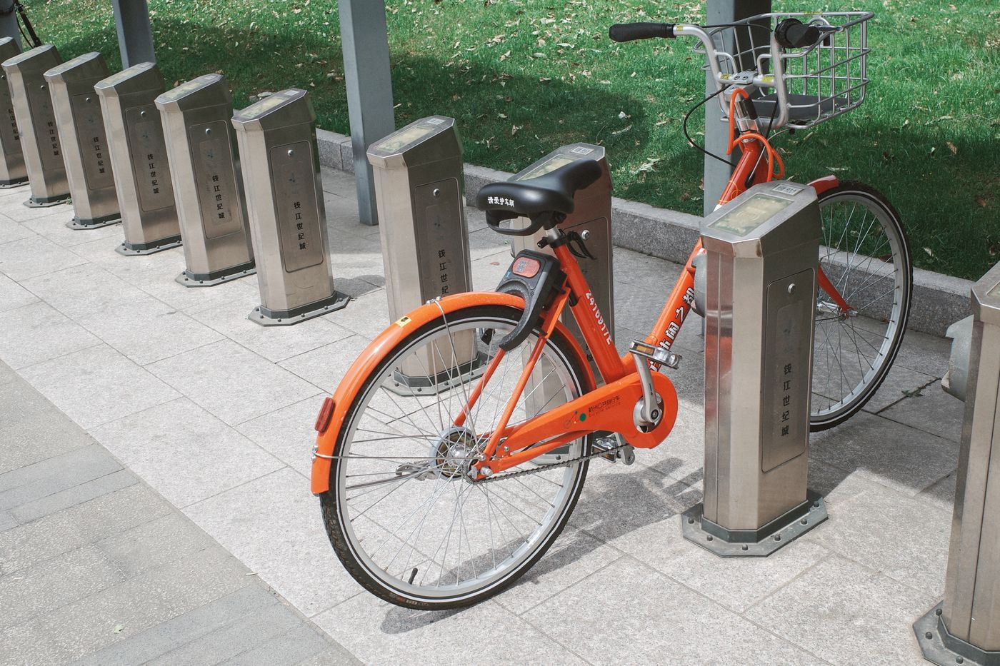
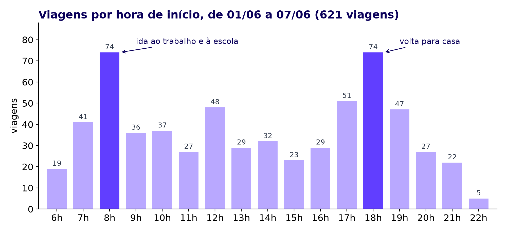

# O cenário: um sistema de bicicletas compartilhadas

> Tipo: **Explicação**

Este nível ensina engenharia de dados fora do Gov Hub, com um exemplo que qualquer pessoa entende: o sistema de bicicletas compartilhadas de uma cidade fictícia, a **Pedala Aurora**. Você vai levar os dados desse sistema da fonte até uma resposta, passando por todas as etapas que um pipeline de verdade tem. Os dados são sintéticos e ficam dentro do próprio notebook: nada para instalar além do Python, nenhuma credencial, nenhum dado pessoal.



## O que você vai aprender

- Como o sistema funciona e que dados ele gera.
- A pergunta que o pipeline do nível vai responder.
- Por que responder uma vez é fácil e responder todo dia, com confiança, é o trabalho de engenharia de dados.
- O caminho completo que você vai construir, aula por aula.

## Como o sistema funciona

A cidade tem oito **estações**. Cada estação é um conjunto de vagas na calçada, onde as bicicletas ficam presas. A pessoa abre o aplicativo, libera uma bicicleta numa estação, pedala e a devolve em qualquer outra estação. Esse percurso, da retirada à devolução, é uma **viagem**.


Cada viagem vira um registro no sistema no momento em que a bicicleta é devolvida. É assim que o dado nasce: ninguém digita nada, ele é um efeito colateral de alguém usar o serviço.

## Os dados que o sistema gera

São dois tipos de dado, e a diferença entre eles aparece em todo pipeline.

**O cadastro das estações** muda pouco. Oito linhas, uma por estação:

| id_estacao | nome | bairro | vagas |
|---|---|---|---|
| E01 | Praça Central | Centro | 20 |
| E02 | Rodoviária | Centro | 15 |
| E03 | Parque das Águas | Jardim Norte | 12 |
| … | … | … | … |

**As viagens** são eventos: chegam todo dia, em volume. Esta é a primeira viagem de 01/06, exatamente como a fonte a entrega:

```text
{'id_viagem': 'V5030',
 'id_usuario': 'U255',
 'estacao_saida': 'E08',
 'estacao_chegada': 'E08',
 'inicio': '2026-06-01T06:30:00-03:00',
 'fim': '2026-06-01T06:53:00-03:00'}
```

**Leia assim:** a viagem V5030 saiu da estação E08 às 6h30 e voltou para a mesma estação às 6h53. A pessoa aparece só como um código (`U255`): a análise precisa saber quantas viagens houve, e não quem pedalou. O `-03:00` no fim do horário é o fuso de Brasília.

## A pergunta

A prefeitura fictícia quer decidir onde pôr mais vagas e para onde levar bicicletas antes dos horários de pico. Para isso, pergunta:

> **Quais estações têm mais saídas por dia, e quanto dura uma viagem típica?**

Só de olhar a semana de dados, um padrão aparece: dois picos, um de manhã e outro no fim da tarde.



## Por que não basta abrir uma planilha

Responder uma vez, com uma exportação na mão, é fácil. O trabalho começa quando a resposta precisa estar certa **todo dia**:

- **O dado chega aos poucos.** Todo dia há viagens novas, e a fonte as entrega por uma API, em páginas.
- **A fonte falha.** Às vezes o servidor está ocupado e não responde na primeira tentativa.
- **O dado vem com defeitos.** Uma viagem repetida, um horário de fim antes do início, uma estação que não está no cadastro.
- **O dado chega atrasado.** Algumas viagens de ontem só aparecem hoje.
- **Outras pessoas vão usar a resposta.** Elas precisam confiar no número sem refazer a conta.

Engenharia de dados é isso: levar o dado da fonte até a resposta, de forma repetível, conferida e que sobreviva aos problemas acima.

## O caminho que você vai construir


| Etapa | O que faz | Aula |
|---|---|---|
| Coleta | Pede as viagens à API, página por página, e guarda cada dia como veio | [Prática: coletar de uma API](../tutoriais/engenharia-fundamentos-coleta.md) |
| Gravação | Leva os arquivos para uma tabela no banco, sem duplicar | [Prática: gravar sem duplicar](../tutoriais/engenharia-fundamentos-gravar.md) |
| Camadas | Converte, limpa, junta e agrega até a resposta | [Prática: transformar em camadas](../tutoriais/engenharia-fundamentos-camadas.md) |
| Testes | Procuram os defeitos antes de alguém usar a resposta | [Prática: testar o dado](../tutoriais/engenharia-fundamentos-testes.md) |
| Orquestração | Roda tudo por dia, na ordem, e reprocessa quando precisa | [Prática: orquestrar o pipeline](../tutoriais/engenharia-fundamentos-orquestrar.md) |

Cada prática tem um notebook com código pronto para observar, um exercício curto e uma célula que confere a sua resposta. A última aula mostra qual ferramenta faz cada uma dessas etapas no Gov Hub.

## Confira o que entendeu

1. O cadastro de estações e as viagens chegam da mesma fonte. Por que vale tratá-los como tipos diferentes de dado?
2. A prefeitura poderia exportar uma planilha das viagens uma vez por semana e responder à pergunta à mão. O que se perde?

## Respostas comentadas

1. Porque mudam em ritmos diferentes e pedem cargas diferentes. O cadastro é pequeno e muda pouco: dá para substituí-lo inteiro a cada carga. As viagens chegam todo dia, em volume: é preciso carregar por dia, sem duplicar, e conseguir refazer um dia específico.
2. A conferência e a repetição. Ninguém percebe a viagem repetida, a estação que não existe ou as viagens que chegaram atrasadas; a conta muda conforme quem a faz; e a resposta envelhece até a próxima exportação. O pipeline faz o mesmo trabalho todo dia, do mesmo jeito, e avisa quando algo está errado.

## Próximos passos

- [Preparar o Jupyter e olhar os dados](../guias/engenharia-fundamentos-jupyter.md)
