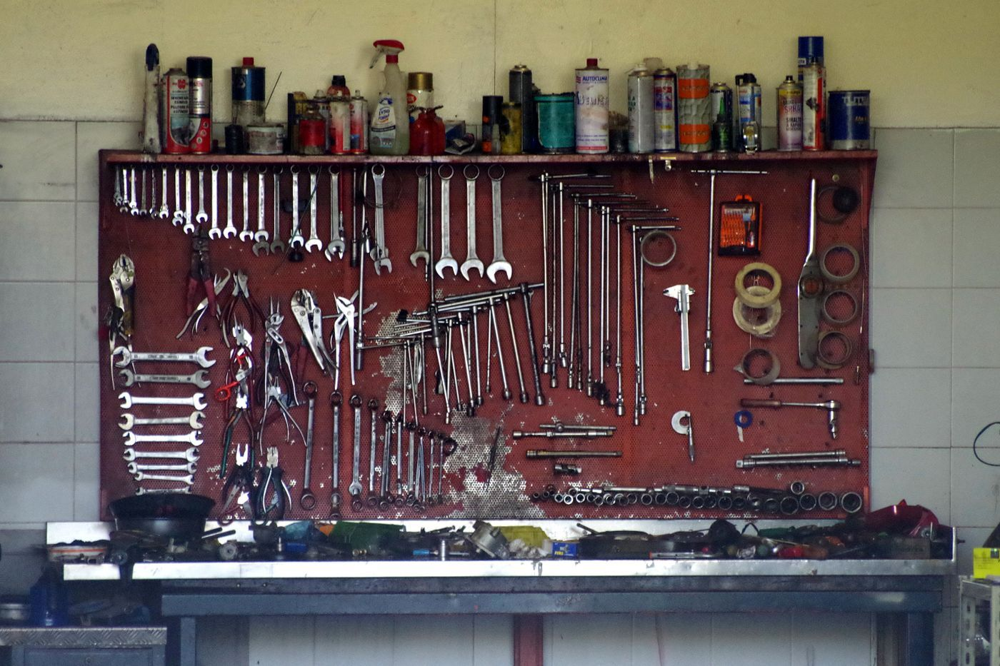

# Do notebook às ferramentas do Gov Hub

> Tipo: **Explicação**

Neste nível, você fez cada etapa de um pipeline com Python e SQL, à mão: coletou, gravou, transformou, testou e orquestrou. O Gov Hub faz exatamente as mesmas coisas, mas com ferramentas feitas para cada uma delas. Esta aula liga o que você já sabe aos nomes que vai encontrar nos próximos níveis.

## O que você vai aprender

- Qual ferramenta do Gov Hub faz cada etapa que você fez no notebook.
- O que muda quando o dado é real, e não fictício.
- Onde cada assunto continua na trilha.

## A mesma ideia, outra ferramenta

![Do notebook ao Gov Hub, em oito pares. A API de mentira corresponde às APIs públicas do governo, como a do PNCP. As funções pedir e coletar_dia correspondem aos clientes da aplicação, em Python. A pasta bruto/ e a raw_viagens correspondem às tabelas raw no PostgreSQL. Apagar e gravar o dia corresponde a cargas que podem rodar de novo sem duplicar. As views bronze e silver e a tabela gold correspondem aos modelos do dbt, nas mesmas três camadas. As consultas de teste correspondem aos testes do dbt. O mini orquestrador corresponde às DAGs do Airflow, com agenda, novas tentativas e histórico. O gold.csv corresponde aos painéis no Superset.](../../assets/diagramas/engenharia-fundamentos-ferramentas.png)

| No notebook | No Gov Hub | Onde continua |
|---|---|---|
| A API de mentira | APIs públicas, como a do PNCP, com paginação e limite de pedidos de verdade | [Prática: coletar dados de uma API com Python](../tutoriais/engenharia-coleta-python.md) |
| `pedir` e `coletar_dia` | Um cliente por fonte, em `plugins/`, que herda de `ClienteBase` | [Fontes e clientes do repositório](../referencia/engenharia-fontes.md) |
| `raw_viagens` no DuckDB | Tabelas raw no PostgreSQL, num schema por fonte | [Prática: gravar a coleta em bancos de dados](../tutoriais/engenharia-ingestao-bancos.md) |
| Apagar e gravar o dia | Cargas idempotentes, completas ou incrementais | [Cargas completas, incrementais e idempotência](engenharia-idempotencia.md) |
| Views bronze e silver, tabela gold | Modelos do dbt: um arquivo SQL por tabela, nas mesmas camadas | [Prática: transformar com dbt, da raw à gold](../tutoriais/engenharia-dbt-camadas.md) |
| Consultas de teste e reconciliação | Testes do dbt, declarados junto de cada modelo | [Validar e entregar uma camada confiável](../guias/engenharia-entrega-camada.md) |
| Mini orquestrador e histórico | DAGs do Airflow, com agenda, `retries` e o histórico de cada execução | [Prática: orquestrar a coleta com o Airflow](../tutoriais/engenharia-airflow-dag.md) |
| `executar("2026-06-05")` | Reprocessar um intervalo de datas | [Reprocessamento e mudanças na fonte](../guias/engenharia-reprocessamento.md) |
| `gold.csv` | Painéis no Superset, que leem a gold | [Validar PostgreSQL e Superset](../guias/engenharia-acessos-locais.md) |

Repare que nenhuma ferramenta inventa uma etapa nova. O dbt não decide quais regras a silver aplica, e o Airflow não decide o que depende do quê: essas decisões continuam sendo suas. As ferramentas fazem o que o seu notebook fazia, com mais segurança, para muitas fontes e muitas pessoas ao mesmo tempo.

## O que muda quando o dado é real

| No nível 0 | No Gov Hub |
|---|---|
| Uma fonte, sempre igual | Várias fontes, cada uma com seu formato, suas falhas e suas mudanças |
| Sem credenciais | Chaves de acesso guardadas fora do código, em Variables e Connections do Airflow |
| Um banco num arquivo | Um PostgreSQL compartilhado, com permissões por camada |
| Você sozinho | Várias pessoas no mesmo repositório, com revisão antes de cada mudança |
| Um código de usuário fictício | Dados que podem ser pessoais, com regras de privacidade na silver |
| Um notebook | Serviços em contêineres (Docker), que o nível 2 ensina a subir |

## Confira o que entendeu

1. No Gov Hub, uma tabela gold aparece com o dobro de linhas depois de alguém reexecutar uma DAG. A partir deste nível, onde você começaria a procurar?
2. O dbt substitui o SQL que você escreveu na aula de camadas?

## Respostas comentadas

1. Na gravação da raw: o sintoma é o da carga que soma em vez de substituir, da aula de gravação. Confira se a carga daquela fonte é idempotente, e depois se algum teste de linha única ou de reconciliação deveria ter pegado o problema.
2. Não. No dbt, você continua escrevendo o mesmo tipo de SQL, um `select` por modelo. O que o dbt acrescenta é a ordem entre os modelos, a criação das tabelas e views, os testes declarados e a documentação.

## Próximos passos

O nível 0 termina aqui. A trilha segue para o Gov Hub:

- [Engenharia de dados: da fonte à decisão](engenharia-papel.md), a primeira aula do nível 1
- [O caminho de uma base nova, da issue ao painel](engenharia-base-nova.md), para ver aonde a trilha chega
