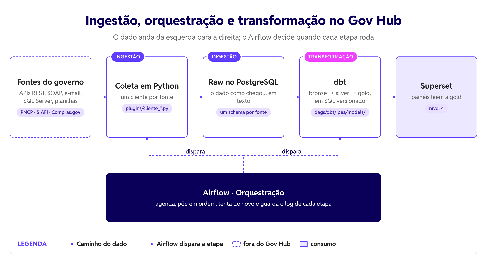
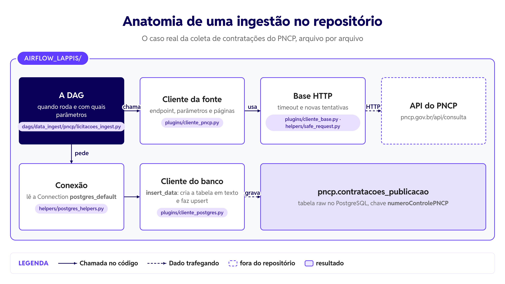

# Ingestão: trazer o dado da fonte para o banco

> Tipo: **Explicação**

## As três palavras deste nível

Todo indicador do Gov Hub passa por três trabalhos diferentes, feitos por ferramentas diferentes:

| Trabalho | Pergunta que responde | Ferramenta no Gov Hub |
|---|---|---|
| **Ingestão** | Como o dado sai da fonte e chega ao nosso banco? | Python, com um cliente por fonte |
| **Orquestração** | Quando cada etapa roda, em que ordem e o que fazer se falhar? | Airflow |
| **Transformação** | Como o dado recebido vira uma tabela pronta para o painel? | dbt, em SQL |



Esta aula trata da primeira. As duas seguintes tratam da orquestração e da transformação. Depois vêm as práticas, em que você faz as três com a mesma fonte.

## O que é ingestão

Ingestão é **copiar o dado de uma fonte externa para dentro do nosso banco, sem mudar o que ele diz**. A fonte pode ser uma API, um serviço SOAP, um anexo de e-mail, outro banco de dados ou uma planilha. O destino, no Gov Hub, é o PostgreSQL.

O resultado da ingestão é a camada **raw**: uma tabela com o dado do jeito que chegou. Raw não é lugar de corrigir tipo, renomear coluna ou calcular indicador. Isso fica para a transformação, onde a regra fica escrita em SQL, versionada e testada.

Na aplicação, isso é literal: o `insert_data` de `plugins/cliente_postgres.py` cria as colunas da raw todas como `TEXT`. Um valor `12055.95` chega como o texto `'12055.95'`, e quem decide que ele é `numeric(15, 2)` é o modelo bronze do dbt.

## Um exemplo concreto: contratações no PNCP

O Portal Nacional de Contratações Públicas (PNCP) publica as compras do governo em uma API aberta, sem senha. Um pedido como este:

```text
GET https://pncp.gov.br/api/consulta/v1/contratacoes/publicacao
    ?dataInicial=20260601&dataFinal=20260630
    &codigoModalidadeContratacao=8&cnpj=00394494000136&pagina=1
```

devolve as dispensas de licitação do Ministério da Justiça em junho de 2026. Cada registro é um JSON com dezenas de campos:

```json
{
  "numeroControlePNCP": "00394494000136-1-000543/2026",
  "objetoCompra": "Aquisição de materiais de monitoramento ...",
  "valorTotalEstimado": 16505.36,
  "valorTotalHomologado": 12055.95,
  "dataPublicacaoPncp": "2026-06-01T08:51:56",
  "orgaoEntidade": { "cnpj": "00394494000136", "razaoSocial": "MINISTERIO DA JUSTICA E SEGURANCA PUBLICA" },
  "unidadeOrgao": { "ufSigla": "DF", "nomeUnidade": "PENITENCIÁRIA FEDERAL EM BRASILIA" }
}
```

A ingestão precisa resolver quatro coisas para esse dado chegar inteiro ao banco:

1. **Pedir certo:** endpoint, filtros e formato das datas (`20260601`, não `2026-06-01`).
2. **Pedir tudo:** a API entrega 10 registros por vez. Os 61 registros do mês vêm em 7 **páginas**, e a coleta precisa percorrer todas.
3. **Aguentar instabilidade:** a resposta pode demorar mais de 10 segundos ou vir com `429 Too Many Requests`. Isso pede **tempo limite** e **nova tentativa com espera**.
4. **Gravar sem duplicar:** se a coleta rodar duas vezes, o banco continua com 61 linhas. Isso é **upsert** pela chave `numeroControlePNCP` (a [idempotência](engenharia-idempotencia.md), detalhada na aula de cargas deste nível).

Paginação, tempo limite e nova tentativa não são assuntos separados: são partes de qualquer coleta. Você vai escrevê-las na prática de Python.

## Como o repositório organiza uma ingestão

A coleta real de contratações do PNCP é dividida em arquivos com papéis fixos. A mesma divisão vale para as outras fontes.



| Pasta em `airflow_lappis/` | O que mora lá | Exemplo |
|---|---|---|
| `plugins/cliente_*.py` | Um **cliente por fonte**: sabe o endereço, os parâmetros, a paginação e o formato da resposta | `cliente_pncp.py`, `cliente_siafi.py` |
| `plugins/cliente_base.py` | A base HTTP comum: `httpx`, tempo limite (`DEFAULT_TIMEOUT = 10`) e até 3 novas tentativas | herdada por `ClientePNCP` |
| `helpers/` | Funções de apoio reaproveitáveis | `safe_request.py`, `retry_helpers.py`, `postgres_helpers.py` |
| `plugins/cliente_postgres.py` | A gravação no banco: `insert_data` cria a tabela, acrescenta colunas novas e faz upsert | usado por quase todas as DAGs |
| `dags/data_ingest/<fonte>/` | As **DAGs**: quando roda, com quais parâmetros, chamando cliente e gravação | `pncp/licitacoes_ingest.py` |

Na DAG do PNCP, o trecho que grava é este:

```python
db.insert_data(
    registros,
    table_name="contratacoes_publicacao",
    conflict_fields=["numeroControlePNCP"],
    primary_key=["numeroControlePNCP"],
    schema="pncp",
)
```

Leia assim: grave `registros` em `pncp.contratacoes_publicacao`; se já existir uma linha com o mesmo `numeroControlePNCP`, atualize em vez de duplicar.

## O que o `insert_data` faz por você e o que ele esconde

Vale conhecer o comportamento do cliente de banco, porque ele aparece nas tabelas raw de todo o projeto:

| Comportamento | Efeito na tabela raw |
|---|---|
| Achata o JSON com `__` | `orgaoEntidade.cnpj` vira a coluna `orgaoentidade__cnpj` |
| Não usa aspas nos nomes | O PostgreSQL guarda tudo em minúsculas: `numeroControlePNCP` vira `numerocontrolepncp` |
| Cria toda coluna como `TEXT` | Tipos ficam para a bronze |
| Acrescenta colunas novas | Se a API passar a mandar um campo novo, a tabela ganha a coluna |
| Usa `pandas.json_normalize` | Um `null` em campo numérico pode virar o texto `'NaN'`. Você vai encontrar isso na prática de dbt |

## Fontes que não são API REST

O PNCP é o caso mais simples. Outras fontes do projeto pedem outros leitores, mas o mesmo desenho: cliente, DAG e `insert_data`.

| Fonte | Como chega | Onde ver |
|---|---|---|
| SIAFI | Serviço SOAP com XML e certificado ICP-Brasil | `plugins/cliente_siafi.py` |
| Relatórios por e-mail | Anexo lido por IMAP | `plugins/cliente_email.py`, `plugins/email_ingest_dag_factory.py` |
| Bancos SQL Server | Consulta com `MsSqlHook` do Airflow | `plugins/cliente_sqlserver.py` |
| Censo e outros arquivos | FTP, CSV, planilhas | `plugins/cliente_ibge.py`, `helpers/` |

A lista completa está na referência [Fontes e clientes do repositório](../referencia/engenharia-fontes.md).

## Para levar desta aula

- Ingestão copia o dado para a raw **sem mudar o que ele diz**.
- Paginar, limitar o tempo, tentar de novo e gravar sem duplicar fazem parte de toda coleta.
- No repositório: cliente em `plugins/`, DAG em `dags/data_ingest/<fonte>/`, gravação pelo `insert_data`.

## Veja também

- [Orquestração: quem roda o quê, quando e em que ordem](engenharia-orquestracao.md)
- [Prática: coletar dados de uma API com Python](../tutoriais/engenharia-coleta-python.md)
