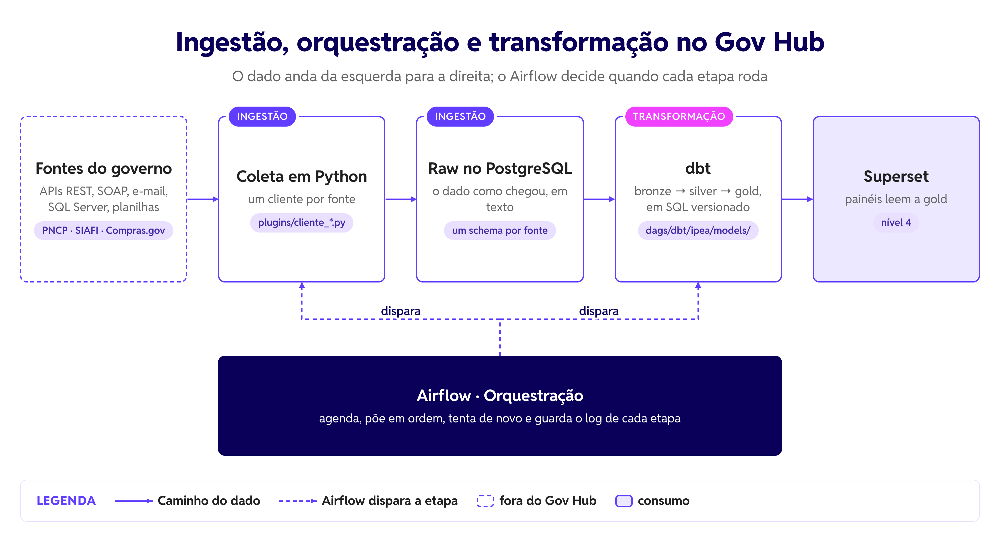
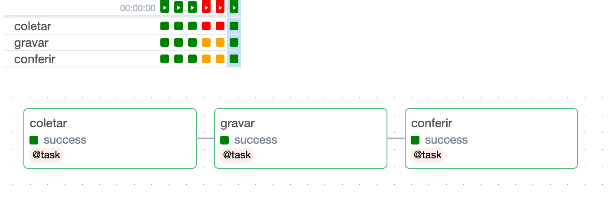
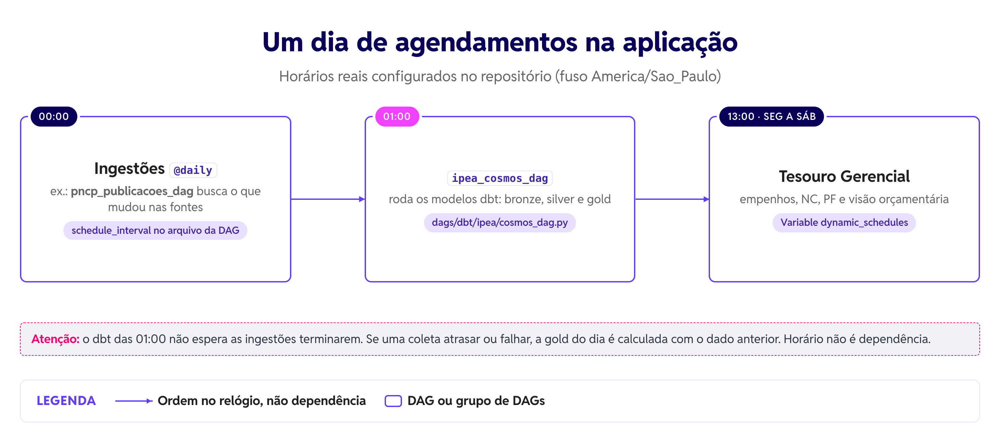
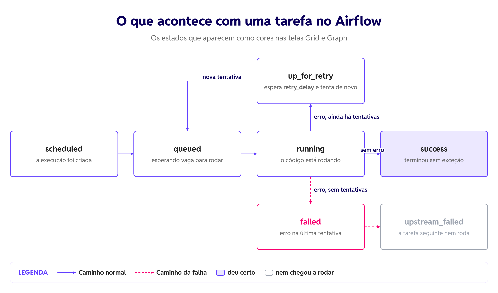
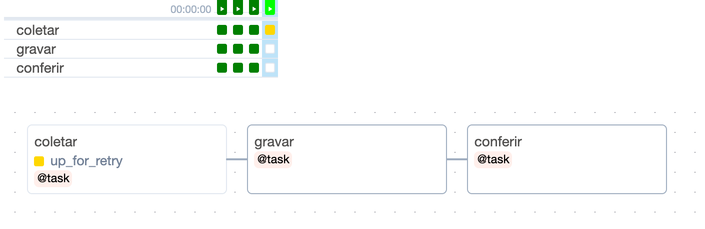
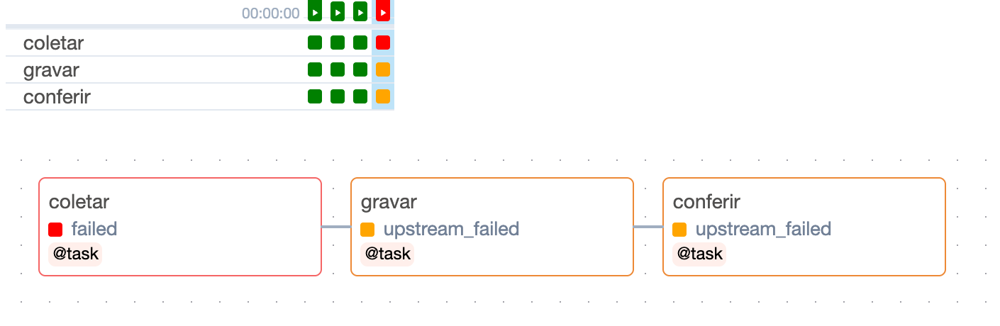

# Orquestração: quem roda o quê, quando e em que ordem

> Tipo: **Explicação**

## O problema que o Airflow resolve

Imagine a coleta do PNCP como três scripts: `coletar.py`, `gravar.py` e `conferir.py`. Para rodá-los todo dia, você poderia agendar cada um no `cron` do servidor. Logo apareceriam as perguntas:

- Se `coletar.py` falhar às 00:03, quem impede `gravar.py` de rodar às 00:05 com dado velho?
- Se a API do PNCP responder `429 Too Many Requests`, quem tenta de novo daqui a dois minutos?
- Onde está o log da execução de terça-feira passada?
- Como reprocessar só a etapa que falhou, sem repetir as outras?

**Orquestrar** é responder a essas perguntas em um lugar só. O Gov Hub usa o **Apache Airflow 2.8.1** para isso. O Airflow não guarda dado de negócio nem calcula indicador: ele decide **quando** cada etapa roda, **em que ordem**, **o que fazer quando falha** e **guarda o log** de tudo.



## DAG, tarefa e execução

No Airflow, um fluxo é uma **DAG** (grafo acíclico dirigido): caixas ligadas por setas que nunca voltam ao início. Cada caixa é uma **tarefa**. Cada vez que a DAG roda, nasce uma **execução** (*DAG run*), com o estado de cada tarefa.

É isto que você vai construir na prática do Airflow: três tarefas, uma depois da outra.



Em código, com a API **TaskFlow** que o repositório usa, a DAG é uma função com `@dag` e cada tarefa é uma função com `@task`:

```python
@dag(schedule=None, start_date=datetime(2026, 1, 1), catchup=False,
     default_args={"retries": 2, "retry_delay": timedelta(minutes=2)})
def formacao_pncp_dag():

    @task
    def coletar() -> list[dict]: ...

    @task
    def gravar(registros: list[dict]) -> int: ...

    @task
    def conferir(enviados: int) -> None: ...

    conferir(gravar(coletar()))
```

A última linha é a parte importante: ao passar o resultado de uma tarefa para a outra, você declara a **ordem**. `gravar` só roda depois que `coletar` termina com sucesso, e recebe a lista que ela devolveu. Esse valor viaja entre tarefas por **XCom**, um mecanismo para mensagens pequenas. Para conjuntos grandes, passe o nome de uma tabela ou de um arquivo, não os dados.

## Quando: agendamento

O parâmetro `schedule` diz quando criar uma execução nova. Os horários reais da aplicação mostram três jeitos de configurar:



| Onde está o horário | Exemplo real | Quando usar |
|---|---|---|
| No arquivo da DAG | `schedule_interval="@daily"` em `pncp/licitacoes_ingest.py` | Horário fixo e simples |
| Expressão cron no arquivo | `" 0 1 * * *"` em `dbt/ipea/cosmos_dag.py` (todo dia à 01:00) | Horário específico |
| Variable `dynamic_schedules` | `{"nc_tesouro_ingest_dag": {"type": "cron", "value": "0 13 * * 1-6"}}` | Mudar o horário sem novo deploy, lido por `plugins/schedule_loader.py` |

Dois parâmetros completam o agendamento:

- `start_date`: a partir de quando a DAG existe.
- `catchup=False`: ao ligar a DAG, **não** criar execuções para todos os dias passados desde `start_date`. Todas as DAGs do repositório usam `False`.

**Horário não é dependência.** A DAG do dbt roda à 01:00 porque, em geral, as coletas da meia-noite já terminaram. Se uma coleta atrasar, o dbt roda mesmo assim e a gold sai com o dado do dia anterior. Ao investigar um número desatualizado, confira primeiro se a coleta do dia terminou.

## O que fazer quando falha: tentativas e estados

`retries` diz quantas vezes tentar de novo depois da primeira falha. `retry_delay` diz quanto esperar entre as tentativas. Com `retries=2`, uma falha persistente gera **três tentativas** da mesma tarefa, na mesma execução.



Na prática do Airflow, você vai provocar uma falha e ver estes estados na tela. Primeiro a tarefa `coletar` falha e fica em **up_for_retry** (amarelo), esperando a próxima tentativa:



Quando as tentativas acabam, `coletar` fica **failed** (vermelho) e `gravar` e `conferir` ficam **upstream_failed** (laranja): não rodaram porque dependiam dela.



Ao investigar, comece **pela primeira tarefa vermelha**. As laranjas não têm defeito próprio; só não puderam rodar.

Há duas camadas de tentativa no projeto, e elas se multiplicam: o `helpers/safe_request.py`, usado pelo cliente do PNCP, faz até 3 tentativas para cada pedido HTTP, e o Airflow repete a tarefa inteira conforme `retries`. Com `retries=2`, um pedido que sempre falha pode ser feito 9 vezes. Isso importa para APIs com limite de requisições.

## Configuração fora do código: Variables e Connections

| Recurso | Para quê | Exemplos na aplicação | Onde ver |
|---|---|---|---|
| **Variable** | Parâmetros que mudam por ambiente | `airflow_orgao`, `airflow_variables` (códigos de UG e CNPJ por órgão), `dynamic_schedules` | Admin → Variables |
| **Connection** | Endereço e credenciais de um sistema | `postgres_default`, usada por `helpers/postgres_helpers.py` | Admin → Connections |

O `make dev` cria essas Variables e a Connection no ambiente local. Em produção, os valores são outros, mas o código é o mesmo. Por isso a DAG nunca deve ter senha nem endereço de banco escritos no arquivo.

## Onde a orquestração mora no repositório

| Caminho | O que tem |
|---|---|
| `airflow_lappis/dags/data_ingest/<fonte>/` | Uma ou mais DAGs de coleta por fonte |
| `airflow_lappis/dags/dbt/ipea/cosmos_dag.py` | A DAG que roda o dbt (veja a prática de dbt) |
| `airflow_lappis/plugins/schedule_loader.py` | Leitura da Variable `dynamic_schedules` |
| `airflow_lappis/airflow.cfg` e `docker-compose.yml` | Configuração do Airflow local: fuso `America/Sao_Paulo`, `LocalExecutor`, modo `standalone` |

## Para levar desta aula

- O Airflow decide **quando**, **em que ordem** e **o que fazer se falhar**; não transforma dado.
- A ordem vem das dependências entre tarefas. O horário só diz quando a DAG começa.
- Investigue pela primeira tarefa vermelha; as laranjas só herdaram a falha.

## Veja também

- [Ingestão: trazer o dado da fonte para o banco](engenharia-ingestao.md)
- [Transformação: da raw à gold com SQL versionado](engenharia-transformacao.md)
- [Prática: orquestrar a coleta com o Airflow](../tutoriais/engenharia-airflow-dag.md)
