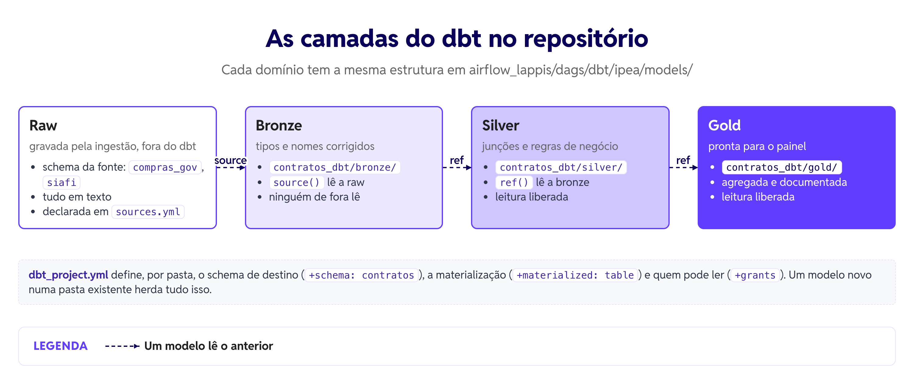
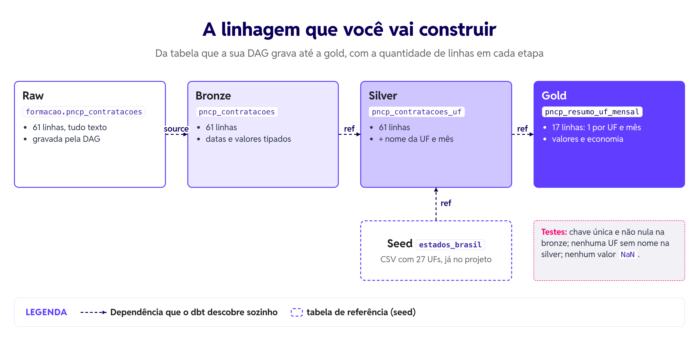
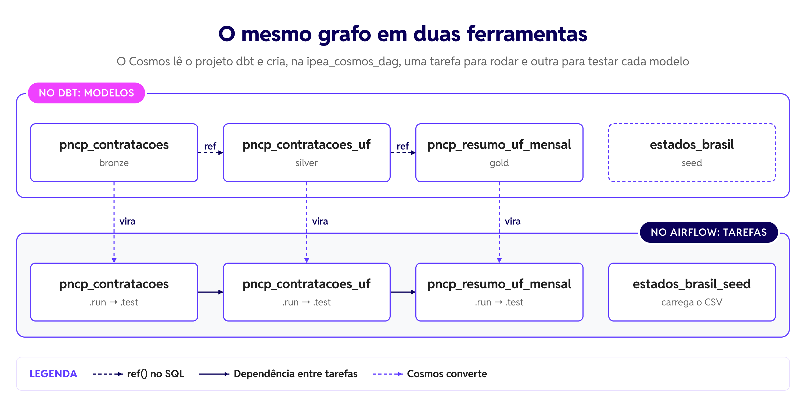

# Transformação: da raw à gold com SQL versionado

> Tipo: **Explicação**

## Por que transformar dentro do banco

A ingestão deixou na raw o dado como chegou: tudo em texto, com nomes de colunas da fonte e sem nenhuma regra. Um painel não pode ler isso diretamente. Alguém precisa converter `'16505.36'` em número, juntar o código da UF com o nome do estado, somar por mês e decidir o que é "economia".

No Gov Hub, esse trabalho é feito **dentro do PostgreSQL, em SQL**, depois da carga. É o padrão ELT que você viu no nível 1: extrair, carregar e só então transformar. A vantagem é que a raw continua intacta: se uma regra estiver errada, você corrige o SQL e recalcula, sem coletar de novo.

A ferramenta que organiza esse SQL é o **dbt**.

## O que o dbt acrescenta a um arquivo `.sql`

Um **modelo** dbt é um arquivo `select`. O dbt cria a tabela ou a visão no banco a partir dele. O que torna isso mais do que uma pasta de consultas:

| Recurso | O que faz | Exemplo |
|---|---|---|
| `source('fonte', 'tabela')` | Lê uma tabela raw declarada em `sources.yml` | `{{ source('formacao', 'pncp_contratacoes') }}` |
| `ref('modelo')` | Lê outro modelo **e registra a dependência** | `{{ ref('pncp_contratacoes') }}` |
| Grafo de dependências | Descobre sozinho a ordem de execução pelos `ref()` | bronze antes de silver, silver antes de gold |
| Materialização | Decide se o resultado vira `table`, `view` ou `incremental` | `{{ config(materialized="table") }}` |
| Testes | Verificam o resultado depois de cada execução | `unique`, `not_null`, ou um `select` que deve voltar vazio |
| Seeds | Tabelas pequenas de referência em CSV, versionadas | `seeds/estados_brasil.csv` |
| Macros | Funções Jinja reaproveitáveis | `parse_financial_value`, para valores como `1.234,56` |

As chaves duplas `{{ }}` são resolvidas pelo dbt antes de o SQL chegar ao banco. Por isso um modelo não roda colado no editor SQL comum.

## As camadas, pasta por pasta

O projeto dbt da aplicação fica em `airflow_lappis/dags/dbt/ipea/`. Cada domínio (contratos, pessoas, TED, orçamento) tem a mesma estrutura de pastas, e cada pasta é uma camada:



| Camada | Pergunta que responde | O que é permitido | Exemplo real |
|---|---|---|---|
| **Bronze** | O dado está com o tipo e o nome certos? | Converter tipos, renomear, tratar vazios | `contratos_dbt/bronze/contratos.sql` |
| **Silver** | O dado está completo e coerente? | Juntar tabelas, remover duplicatas, aplicar regras | `contratos_dbt/silver/contratos_empenhos.sql` |
| **Gold** | O dado responde à pergunta do painel? | Agregar, calcular indicadores, nomes de negócio | `contratos_dbt/gold/contratos_resumo.sql` |

O arquivo `dbt_project.yml` aplica configurações por pasta. Um trecho real:

```yaml
contratos_dbt:
  +materialized: table
  +schema: contratos
  bronze:
    +materialized: incremental
    +grants:
      select: []
  silver:
    +grants:
      select: ["{{ env_var('DB_DW_READONLY_ROLE', 'de_postgres') }}"]
```

Leia assim: todo modelo em `contratos_dbt/` vira tabela no schema `contratos`; a bronze é incremental e ninguém de fora a lê; a silver pode ser lida pelo papel somente leitura. Um modelo novo numa pasta existente herda tudo isso, sem você escrever nada.

## Um exemplo pequeno, do início ao fim

Na prática de dbt, você vai construir esta linhagem com os dados da sua coleta do PNCP:



A gold tem poucas linhas e responde a uma pergunta clara:

```sql
select
    uf_sigla,
    nome_uf,
    mes_referencia,
    count(*) as contratacoes,
    count(valor_homologado) as contratacoes_homologadas,
    sum(valor_estimado) as valor_estimado,
    sum(valor_homologado) as valor_homologado,
    sum(valor_estimado - valor_homologado) as economia
from {{ ref("pncp_contratacoes_uf") }}
group by uf_sigla, nome_uf, mes_referencia
```

| uf_sigla | nome_uf | contratacoes | homologadas | valor_estimado | valor_homologado | economia |
|---|---|---|---|---|---|---|
| SC | SANTA CATARINA | 4 | 4 | 179.185,95 | 130.763,95 | 48.422,00 |
| DF | DISTRITO FEDERAL | 13 | 12 | 3.294.941,07 | 3.206.150,23 | 42.110,84 |
| RS | RIO GRANDE DO SUL | 3 | 2 | 110.680,00 | 48.630,00 | 39.160,00 |

Repare no Rio Grande do Sul: estimado menos homologado daria 62.050,00, mas a economia é 39.160,00. Uma das três contratações ainda não foi homologada, e a regra só calcula economia onde há os dois valores. Esse tipo de decisão é regra de negócio: fica escrita na gold, versionada e revisável, e não espalhada em painéis.

## Testes: o que precisa ser verdade no resultado

Um modelo que roda sem erro pode estar errado. Os testes do dbt verificam o resultado:

```yaml
models:
  - name: pncp_contratacoes
    columns:
      - name: numero_controle_pncp
        tests:
          - not_null
          - unique
```

`dbt build` roda cada modelo e, logo depois, os testes dele. Se um teste falhar, os modelos que dependem dele não rodam, e o erro não chega à gold.

## Como o dbt roda todo dia: Cosmos

Você roda o dbt pelo terminal enquanto desenvolve. Em produção, quem roda é o Airflow, pela DAG `ipea_cosmos_dag` em `dags/dbt/ipea/cosmos_dag.py`, todo dia à 01:00.

O **Astronomer Cosmos** é a biblioteca que faz essa ponte: ele lê o projeto dbt e cria, no Airflow, uma tarefa para rodar e outra para testar cada modelo, ligadas na mesma ordem dos `ref()`. Você não escreve essas tarefas: elas aparecem sozinhas quando um modelo novo entra no projeto.



## Para levar desta aula

- Transformar é escrever SQL sobre a raw, dentro do banco, sem alterar a raw.
- `source()` lê o que a ingestão gravou; `ref()` lê outro modelo e define a ordem.
- Bronze corrige tipos, silver aplica regras, gold responde ao painel. A pasta define a camada.
- Os testes impedem que um erro chegue à gold; o Cosmos põe tudo isso no Airflow.

## Veja também

- [Orquestração: quem roda o quê, quando e em que ordem](engenharia-orquestracao.md)
- [Prática: transformar com dbt, da raw à gold](../tutoriais/engenharia-dbt-camadas.md)
- [Raw, bronze, silver e gold](engenharia-camadas.md)
