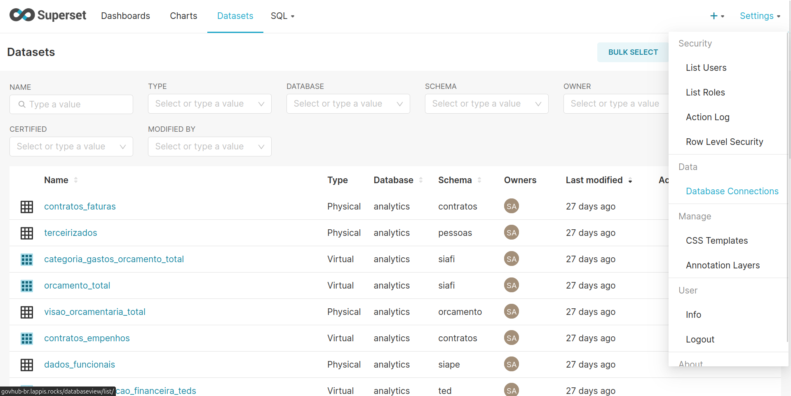
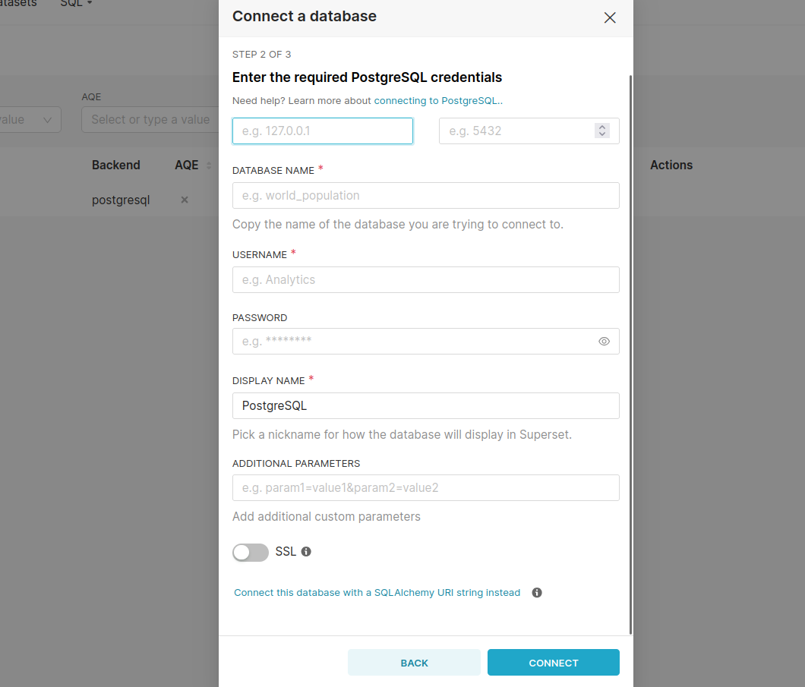

# Validar PostgreSQL e Superset

> Tipo: **Guia**

## Objetivo

Conectar o Superset ao mesmo PostgreSQL validado no Airflow e conferir os acessos usados nas práticas. Ainda não é necessário carregar fontes governamentais.

## 1. Conferir o banco local

Na raiz da aplicação, execute:

```bash
docker compose exec postgres sh -c 'psql -U "$POSTGRES_USER" -d "$POSTGRES_DB" -c "select current_database(), current_user;"'
```

A saída deve identificar o banco e o usuário definidos no `.env`. Em um cliente SQL instalado no computador, conecte com esses mesmos parâmetros e host `localhost`, porta `5432`.

| Origem da conexão | Host PostgreSQL |
|---|---|
| Cliente SQL no computador | `localhost` |
| Airflow ou Superset no mesmo Compose | `postgres` |

Usar `localhost` dentro do Superset aponta para o próprio contêiner Superset. O nome `postgres` identifica o serviço de banco na rede do Compose.


## 2. Cadastrar a conexão no Superset

Abra `http://localhost:8088`. O bootstrap deste ambiente cria o acesso local `admin` / `admin`. Entre em **Settings → Data → Database Connections**.



Clique em **+ DATABASE** e selecione **PostgreSQL** em **Connect a database**. Preencha:

| Campo | Valor para esta prática |
|---|---|
| Host | `postgres` |
| Port | `5432` |
| Database Name | Valor de `POSTGRES_DB`, padrão `postgres` |
| Username | Valor de `POSTGRES_USER`, padrão `postgres` |
| Password | Valor de `POSTGRES_PASSWORD` do `.env` |
| Display Name | `Gov Hub local` |



O `127.0.0.1` exibido como sugestão na imagem não é o host desta instalação em Compose. Use `postgres` e clique em **Connect**. A conexão deve ser aceita e aparecer na lista com o nome **Gov Hub local**.

Aqui usamos a conta local de preparação para conferir a integração. Para o consumo de dados analíticos com permissões restritas, configure uma conta de leitura. O alvo `make setup-roles`, quando disponível na aplicação, prepara o perfil definido em `DB_DW_READONLY_ROLE`; as permissões sobre os schemas e tabelas também precisam ser concedidas. A conexão analítica cadastrada nesta tela é distinta do banco interno de metadados do Superset.

## 3. Executar uma consulta no Superset

Abra **SQL → SQL Lab** ou **SQL → SQL Editor**, conforme a versão. Selecione **Gov Hub local** e execute:

```sql
select current_database() as banco, current_user as usuario;
```

Confira se banco e usuário coincidem com a validação do PostgreSQL. Isso verifica o percurso **Superset → PostgreSQL**, sem depender de uma tabela analítica pronta.

Após concluir a próxima aula de dbt, volte ao editor e execute:

```sql
select id, situacao, valor_global
from contratos.contratos
limit 10;
```

Nesse momento, também será possível acessar **Datasets → + DATASET**, escolher **Gov Hub local**, o schema **contratos** e a tabela **contratos**, e salvar. O dataset disponibiliza a tabela para os gráficos; ele não executa a carga nem substitui os modelos dbt.

## Pronto

O PostgreSQL responde, a conexão **Gov Hub local** executa SQL no Superset. Na próxima aula, você ajustará o dbt existente para o banco local e executará um modelo que poderá consultar e cadastrar como dataset.

## Referências

- [PostgreSQL](https://gov-hub.io/documentacao/infraestrutura/postgres/)
- [Superset](https://gov-hub.io/documentacao/visualizacao/superset/)

As capturas de conexão são da documentação Gov Hub; use os parâmetros locais indicados nesta aula.

## Veja também

- [Validar o Airflow e suas integrações](engenharia-airflow-configuracao.md)
- [Executar o dbt e conferir os dados no banco](engenharia-dbt-configuracao.md)
