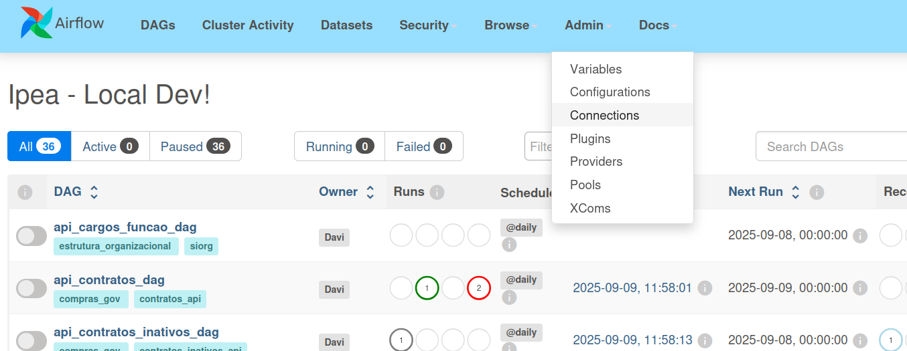
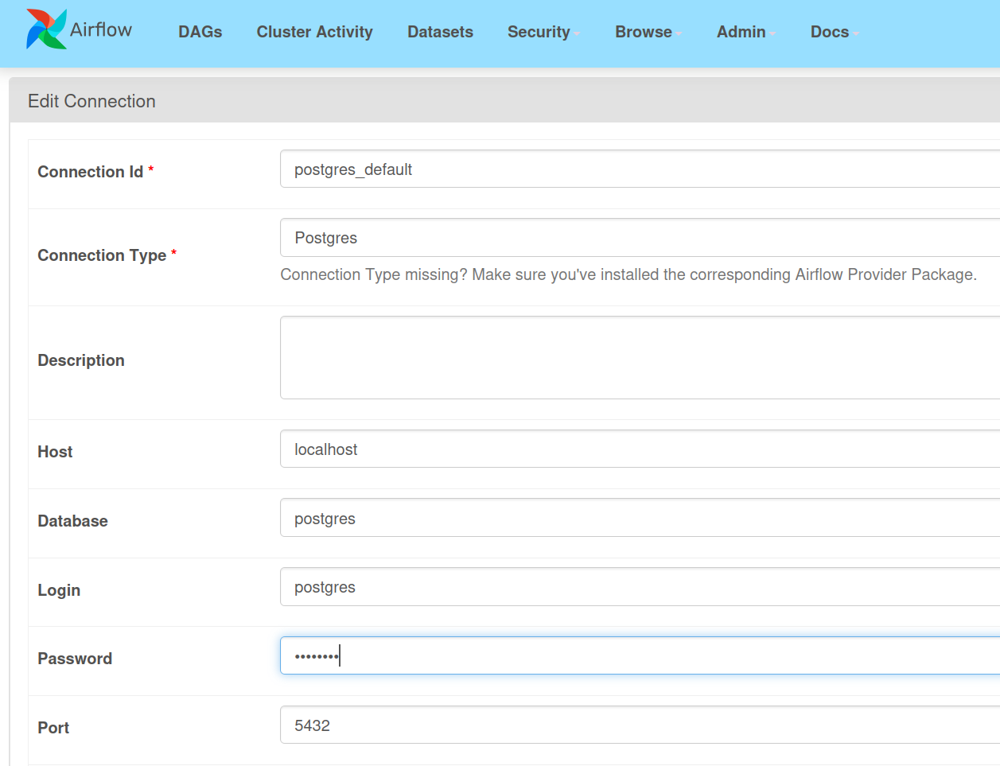
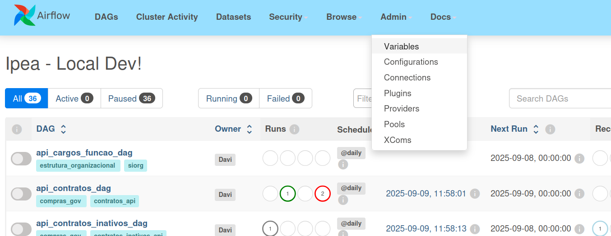
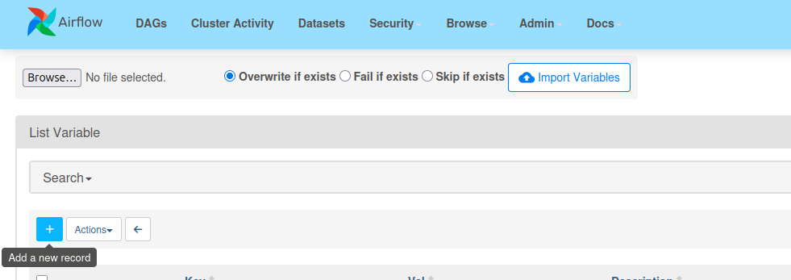
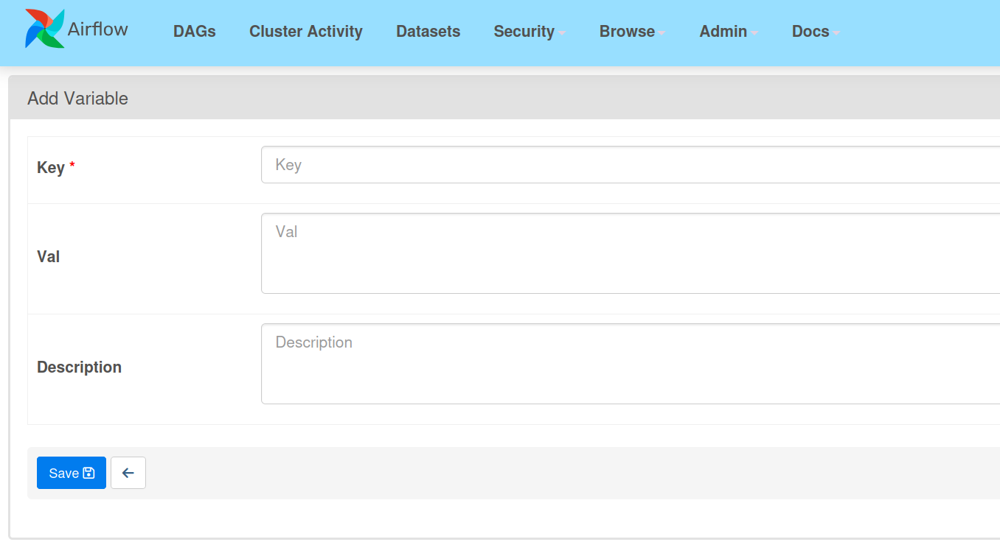

# Validar o Airflow e suas integrações

> Tipo: **Guia**

## Objetivo

Conferir a conexão PostgreSQL usada pelas DAGs e os parâmetros de órgão e agendamento. O `make setup` já chama `make dev` para cadastrar esses itens; use a interface para conferir os valores e completar a configuração, se necessário.

Abra `http://localhost:8080` e entre com o usuário e a senha definidos em `_AIRFLOW_WWW_USER_USERNAME` e `_AIRFLOW_WWW_USER_PASSWORD` no `.env`. O padrão local é `airflow` / `airflow`.

## 1. Configurar o banco usado pelas DAGs

Entre em **Admin → Connections**.



Procure **postgres_default** e clique no lápis para editar. Se a conexão ainda não existir, clique em **+** para criá-la. Preencha os campos abaixo com os parâmetros do PostgreSQL local:

| Campo | Valor no Compose padrão |
|---|---|
| Connection Id | `postgres_default` |
| Connection Type | `Postgres` |
| Host | `postgres` |
| Database | Valor de `POSTGRES_DB`, padrão `postgres` |
| Login | Valor de `POSTGRES_USER`, padrão `postgres` |
| Password | Valor de `POSTGRES_PASSWORD` do `.env` |
| Port | `5432` |



**Na captura aparece `localhost`; no Compose desta trilha, preencha `postgres`.** A conexão parte do contêiner Airflow. O campo **Database** identifica o banco; na representação interna da Connection, esse mesmo valor aparece como `schema`. Ele não é o schema analítico, como `ipea`.

Clique em **Save**. Uma DAG que usa `postgres_conn_id="postgres_default"` passa a buscar essa configuração. DAGs que declaram outro identificador precisam da conexão correspondente; não basta cadastrar uma conexão com nome diferente. Esse cadastro também não altera a conexão interna de metadados do Airflow nem o perfil do dbt.

## 2. Cadastrar as Variables

Entre em **Admin → Variables**. Para editar uma chave existente, use o lápis; para criar uma nova, clique em **+**.





No formulário, **Key** recebe o nome da variável e **Val** recebe o conteúdo. Salve uma variável por vez; nos valores JSON, copie o objeto inteiro, com aspas duplas e sem as marcações do bloco de código.



### airflow_orgao

Em **Key**, informe `airflow_orgao`. Em **Val**, informe `ipea`, sem aspas. Esse valor seleciona o órgão usado pelas rotinas que consultam essa variável.

### airflow_variables

Em **Key**, informe `airflow_variables`. Em **Val**, copie a configuração por órgão usada pelo `make dev`:

```json
{
  "ipea": {"codigos_ug": [113601, 113602]},
  "unb": {"codigos_ug": [154040]},
  "ibama": {"codigos_ug": [440001, 440048, 440050]},
  "mgi": {"codigos_ug": [201082]},
  "mir": {"codigos_ug": [230002, 810008]}
}
```

Para `airflow_orgao=ipea`, as rotinas que usam essa configuração encontram as UGs `113601` e `113602`. A chave do órgão deve existir no objeto; alterar apenas o nome do órgão não cria seus parâmetros.

### dynamic_schedules

Em **Key**, informe `dynamic_schedules`. Em **Val**, copie:

```json
{
  "empenhos_tesouro_ingest_dag": {"type": "cron", "value": "0 13 * * 1-6"},
  "nc_tesouro_ingest_dag": {"type": "cron", "value": "0 13 * * 1-6"},
  "pf_tesouro_ingest_dag": {"type": "cron", "value": "0 13 * * 1-6"},
  "visao_orcamentaria_ingest": {"type": "cron", "value": "0 13 * * 1-6"}
}
```

As chaves são identificadores de DAGs, não nomes de arquivos. A expressão agenda a execução às 13h, de segunda a sábado, no fuso efetivo da DAG. Confira o próximo horário na interface. O agendamento só é aplicado pelas DAGs que leem essa variável; mantenha as coletas pausadas durante a preparação.

## 3. Conferir a importação e a conexão

Na raiz da aplicação, execute:

```bash
make dev-check
docker compose exec airflow airflow dags list
docker compose exec airflow airflow dags list-import-errors
```

O primeiro comando verifica a presença dos cadastros; ele não testa uma consulta ao banco. A listagem deve conter a DAG que você pretende estudar, sem erro de importação associado a ela. Os diretórios `dags/`, `plugins/` e `helpers/` do projeto são montados no contêiner.

Para testar a conexão cadastrada usando o mesmo mecanismo das tarefas PostgreSQL, execute:

```bash
docker compose exec airflow python -c 'from airflow.providers.postgres.hooks.postgres import PostgresHook; print(PostgresHook(postgres_conn_id="postgres_default").get_first("select current_database(), current_user"))'
```

O resultado deve identificar o banco e o usuário locais configurados. Esse teste executa uma consulta de leitura, sem disparar DAGs nem carregar dados de uma fonte externa.

Se precisar reaplicar todos os padrões, revise os parâmetros `AIRFLOW_LOCAL_*` do Makefile e execute `make dev`. Esse comando substitui os valores dessas Variables e da Connection; personalizações da interface precisam ser refletidas na configuração antes de reaplicá-lo.

## Pronto

A conexão responde ao SQL de conferência, as três Variables estão cadastradas e a DAG de estudo é importada. A execução das coletas fica para o nível de ingestão e orquestração.

## Referências

- [Airflow na documentação Gov Hub](https://gov-hub.io/documentacao/pipeline/airflow/)
- [Conexões no Airflow 2.8.1](https://airflow.apache.org/docs/apache-airflow/2.8.1/howto/connection.html)

As capturas são da documentação Gov Hub; os valores das tabelas e blocos acima correspondem ao ambiente Compose deste percurso.

## Veja também

- [Inicializar os serviços com make setup](../tutoriais/engenharia-ambiente.md)
- [Validar PostgreSQL e Superset](engenharia-acessos-locais.md)
