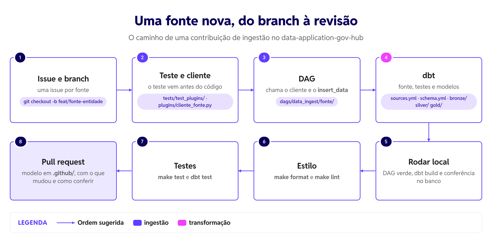

# Guia: adicionar uma fonte nova ao repositório

> Tipo: **Guia**

## Objetivo

Levar uma fonte nova da issue ao pull request no `data-application-gov-hub`, colocando cada peça no lugar que o projeto espera: cliente, DAG, fonte no dbt, modelos e testes.

Este guia junta o que você fez nas práticas deste nível com as regras do repositório, descritas em `.github/CONTRIBUTING.md` e em `.claude/skills/govhub-pipeline-guide/SKILL.md`. O processo de revisão e aprovação do pull request está em [Contribuir com uma mudança revisável](engenharia-contribuicao.md), no nível 5.



## Antes de começar

- Uma issue descrevendo a fonte, as tabelas e as camadas dbt necessárias.
- O projeto dbt de destino confirmado com a equipe: `ipea` (em `dags/dbt/ipea/`) ou outro. A escolha muda os caminhos de `source()` e das pastas.
- As perguntas da tabela "Perguntas para qualquer fonte nova", em [Fontes e clientes do repositório](../referencia/engenharia-fontes.md), respondidas: autenticação, período, paginação, limite, chave e formatos.

## Passos

### 1. Criar a branch

Os prefixos seguem o padrão Conventional Commits do `CONTRIBUTING.md`:

```bash
git checkout -b feat/pncp-contratos
```

### 2. Escrever o teste do cliente e depois o cliente

O teste vem antes do código. Ele fica em `tests/test_plugins/test_cliente_<fonte>.py` e simula a API com `unittest.mock`, sem chamar a internet. Veja `tests/test_plugins/test_cliente_ted.py` e `tests/test_plugins/test_cliente_base.py`.

Cubra pelo menos: uma página com dados, a lista vazia e um erro HTTP. Pela lição da prática do Airflow, inclua um caso para o esgotamento das tentativas: a coleta deve **falhar**, e não devolver uma lista parcial.

Depois, crie `plugins/cliente_<fonte>.py`. Para API REST, herde `ClienteBase`, como `ClientePNCP` e `ClienteTed`:

```python
from cliente_base import ClienteBase


class ClienteFonte(ClienteBase):
    BASE_URL = "https://api.exemplo.gov.br"

    def __init__(self) -> None:
        super().__init__(base_url=ClienteFonte.BASE_URL)

    def get_registros(self, pagina: int) -> tuple[list[dict], int]:
        _, corpo = self.request("GET", "/v1/registros", params={"pagina": pagina})
        return corpo["data"], corpo["totalPaginas"]
```

O cliente só conversa com a fonte e devolve `list[dict]`. Ele não grava no banco nem calcula indicador. Credenciais vêm de variáveis de ambiente ou de Connections, nunca do código.

### 3. Escrever a DAG

Crie `dags/data_ingest/<fonte>/<entidade>_ingest_dag.py` no padrão TaskFlow, como na prática:

- `schedule_interval=get_dynamic_schedule("<fonte>_<entidade>_ingest_dag")`, para o horário ficar na Variable `dynamic_schedules`.
- `catchup=False`, `retries` e `retry_delay` em `default_args`, e `tags` com a fonte.
- Gravação com `ClientPostgresDB(get_postgres_conn()).insert_data(...)`, com `schema` igual ao nome da fonte e `conflict_fields` com a chave natural.
- Uma verificação que falha quando a coleta vem incompleta.
- Filtros por órgão lidos de `Variable.get("airflow_variables")`, como na DAG do PNCP, e não escritos no arquivo.

Escreva também um teste da DAG: o guia de pipeline sugere `tests/dags/`, verificando que a DAG carrega e chama o `insert_data`. Depois, rode-a localmente até ficar verde e confira as linhas no banco.

### 4. Declarar a fonte e escrever os modelos

No projeto dbt escolhido:

1. Acrescente a tabela raw em `models/sources.yml`, sob o nome da fonte (o mesmo `schema` usado no `insert_data`).
2. Escreva o `schema.yml` de cada camada **antes** do SQL, com `unique` e `not_null` na chave.
3. Crie os modelos em `models/<dominio>_dbt/bronze/`, `silver/` e `gold/`. Se o domínio for novo, acrescente o bloco dele no `dbt_project.yml`, copiando a estrutura de `contratos_dbt` (schema, materialização e `grants` por camada).
4. Rode `dbt build --select <modelo_bronze>+` e **olhe a gold**, como no passo 8 da prática de dbt. Valores `NaN`, vazios e totais que não batem com a fonte viram testes.

### 5. Conferir estilo e testes

Na raiz do repositório:

```bash
make format
make lint
make test
```

`make format` aplica `black`, `ruff` e `sqlfmt`. `make lint` verifica os mesmos, mais `mypy` e `sqlfluff`. `make test` roda o `pytest` com cobertura. Os três precisam passar antes do pull request.

### 6. Abrir o pull request

Faça commits no padrão `feat(<fonte>): ...` e abra o pull request para a `main`. O modelo em `.github/PULL_REQUEST_TEMPLATE.md` pede descrição, tipo de mudança, issue relacionada, domínio de revisão e **como testar**: inclua os comandos (`dbt test --select ...`, `airflow dags test ...`) e os números que você conferiu.

## Arquivos de uma fonte nova, de uma vez

| Arquivo | Passo |
|---|---|
| `tests/test_plugins/test_cliente_<fonte>.py` | 2 |
| `airflow_lappis/plugins/cliente_<fonte>.py` | 2 |
| `airflow_lappis/dags/data_ingest/<fonte>/<entidade>_ingest_dag.py` | 3 |
| `tests/dags/test_<fonte>_<entidade>_ingest_dag.py` | 3 |
| `airflow_lappis/dags/dbt/ipea/models/sources.yml` | 4 |
| `airflow_lappis/dags/dbt/ipea/models/<dominio>_dbt/{bronze,silver,gold}/` com `schema.yml` | 4 |
| `airflow_lappis/dags/dbt/ipea/dbt_project.yml`, se o domínio for novo | 4 |

Fora do pull request: `.env`, notebooks e arquivos de estudo, como a pasta `formacao` das práticas.

## Como verificar

- A DAG aparece sem *Import Error*, roda verde e o número de linhas no banco bate com o total da fonte.
- `dbt build` passa e a gold tem valores plausíveis, conferidos contra uma amostra da fonte.
- `make lint` e `make test` passam.
- Outra pessoa consegue repetir a validação seguindo a seção "Como testar" do pull request.

## Veja também

- [Fontes e clientes do repositório](../referencia/engenharia-fontes.md)
- [Comandos do dia a dia: Airflow, dbt e banco](../referencia/engenharia-comandos.md)
- [Contribuir com uma mudança revisável](engenharia-contribuicao.md)
