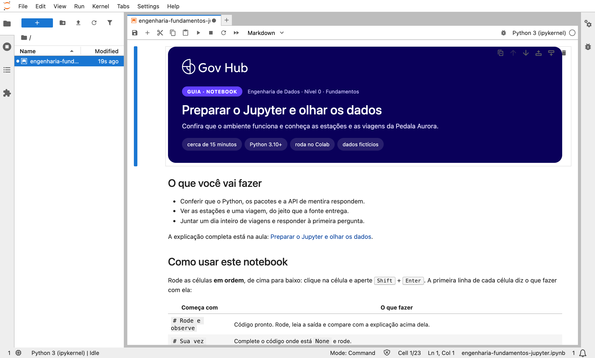

# Preparar o Jupyter e olhar os dados

> Tipo: **Guia**

> Notebook: [engenharia-fundamentos-jupyter.ipynb](../../notebooks/engenharia-fundamentos-jupyter.ipynb) · Colab

Todas as práticas deste nível são notebooks. Este guia mostra três formas de abri-los e confere que tudo funciona. Ao mesmo tempo, você já olha as estações e as viagens da Pedala Aurora.

## O que você vai aprender

- O que é um notebook e por que ele roda célula por célula.
- Abrir um notebook no Colab, no VS Code ou no JupyterLab.
- Ler os três tipos de célula das práticas: observar, fazer e conferir.

## O que é um notebook

Um notebook (`.ipynb`) é um documento com dois tipos de célula: **texto**, com a explicação, e **código**, que você roda ali mesmo e cuja saída aparece logo abaixo. O que uma célula cria (uma variável, uma função, uma tabela) fica disponível para as células seguintes. Por isso a ordem importa: rode de cima para baixo.



## Escolha onde rodar

Os três caminhos levam ao mesmo resultado. Escolha um.

| Onde | Para quem | Como |
|---|---|---|
| **Google Colab** | Quem não quer instalar nada | Clique em **Abrir no Colab**, no cartão acima, e entre com uma conta Google |
| **VS Code** | Quem já usa o editor | Baixe o notebook, abra o arquivo e escolha um Python 3.10 ou mais novo quando o editor pedir |
| **JupyterLab** | Quem prefere rodar no navegador, na própria máquina | Siga os comandos abaixo |

No VS Code, instale antes a extensão **Jupyter**, da Microsoft. Para o JupyterLab, numa pasta com o notebook baixado:

<!-- explica: Cria um ambiente Python só para este estudo, na pasta .venv, e o ativa: o que você instalar a seguir fica separado do resto da máquina. No Windows, o segundo comando é .venv\Scripts\activate. -->

```bash
python3 -m venv .venv
source .venv/bin/activate
```

<!-- explica: Instala o JupyterLab nesse ambiente e o abre no navegador, mostrando os arquivos da pasta. Clique no notebook para abri-lo. -->

```bash
pip install jupyterlab
jupyter lab
```

Os pacotes que as práticas usam (`duckdb`, `httpx` e `pandas`) são instalados pela primeira célula de cada notebook, em qualquer um dos três caminhos.

## Como as práticas são organizadas

A primeira linha de cada célula de código diz o que fazer com ela:

| Começa com | O que fazer |
|---|---|
| `# Rode e observe` | Código pronto. Rode, leia a saída e compare com a explicação acima dela |
| `# Sua vez` | Complete o código onde está `None` e rode |
| `# Confira` | Rode depois da sua vez: ela mostra `[OK]` se está certo, `[ERRO]` com o que falta, ou `[AVISO]` se você ainda não respondeu |

Abaixo de cada "Sua vez" há um **Ver uma resposta**, recolhido. Tente antes de abrir.

![A parte final do notebook no JupyterLab: a célula Sua vez respondida com value_counts, a saída E05, a célula Confira com o quadro roxo [OK] Isso: E05 teve mais saídas em 01/06 e, abaixo, o botão recolhido Ver uma resposta](../../assets/capturas/engenharia/fundamentos-jupyterlab-sua-vez.png)

Cada notebook começa com a seção **Preparação**. Ela instala os pacotes, carrega os quadros de conferência e cria o cenário. A célula do cenário fica recolhida: ela gera os dados e liga uma **API de mentira** dentro do próprio notebook, que se comporta como uma API de verdade. Você não precisa ler esse código para seguir.

## Passo a passo no notebook

**Passo 1, o ambiente responde.** Três quadros com `[OK]`: a versão do Python, a dos pacotes e a resposta `200` da API.

**Passo 2, as estações.** A tabela com as oito estações do cadastro.

**Passo 3, uma viagem.** A primeira página de 01/06. A resposta tem os campos de controle e a lista de viagens:

```text
{'data': '2026-06-01', 'pagina': 1, 'total_paginas': 3, 'total_registros': 88}
{'id_viagem': 'V5030',
 'id_usuario': 'U255',
 'estacao_saida': 'E08',
 'estacao_chegada': 'E08',
 'inicio': '2026-06-01T06:30:00-03:00',
 'fim': '2026-06-01T06:53:00-03:00'}
```

**Passo 4, um dia inteiro.** Um laço pede as três páginas, junta tudo numa tabela e desenha as viagens por hora:

```text
88 viagens em 3 páginas
```

**Sua vez.** Descubra a estação com mais saídas em 01/06. A resposta é `E05`, a Universidade.

## Se algo der errado

| O que aparece | Por quê | O que fazer |
|---|---|---|
| `ModuleNotFoundError: No module named 'duckdb'` | A célula `%pip install` não rodou, ou rodou em outro Python | Rode a primeira célula da Preparação; no VS Code, confira o Python escolhido |
| `NameError: name 'API' is not defined` | Uma célula rodou antes da Preparação | Rode o notebook de cima para baixo; no menu, **Run All** ou **Executar tudo** |
| `[AVISO]` **Ainda sem resposta**, na Confira | A célula Sua vez ainda tem `None` | Complete a célula Sua vez, rode-a e rode a Confira de novo |

## Confira o que entendeu

1. Você reiniciou o kernel e rodou direto a célula do Passo 4. O que acontece, e por quê?
2. Por que as práticas trazem uma API de mentira, em vez de usar uma API pública de verdade?

## Respostas comentadas

1. Um `NameError`: `httpx` e `API` foram criados pelas células anteriores, e reiniciar o kernel apaga tudo o que estava na memória, inclusive a API de mentira. Rode a Preparação e os passos anteriores antes.
2. Para que a prática funcione igual para todo mundo, sempre: sem internet instável, sem limite de pedidos e com os mesmos defeitos aparecendo nos mesmos lugares. Assim a aula pode mostrar a saída exata que você vai ver. As APIs de verdade aparecem nos níveis seguintes, com o PNCP.

## Próximos passos

- [Prática: coletar de uma API](../tutoriais/engenharia-fundamentos-coleta.md)
