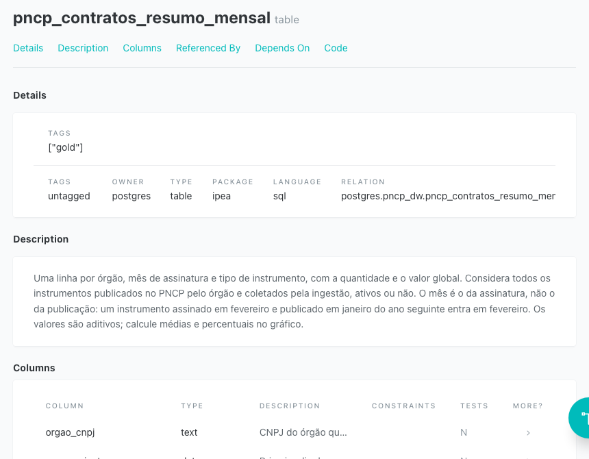

# Documentar a tabela e conferir o que o consumo enxerga

> Tipo: **Guia**

## Objetivo

Deixar a gold pronta para quem vai usá-la sem conversar com você: com descrições que respondem às perguntas certas, a linhagem navegável, o acesso conferido do ponto de vista de quem consome e a resposta a "esta tabela está atualizada?".

![O que alguém de fora precisa saber sobre a tabela e onde cada resposta mora. A descrição do modelo no schema.yml diz o que a linha é, a população e o que a ausência significa, e aparece na documentação gerada pelo dbt, junto com a linhagem. O acesso mostra à role de leitura só a silver e a gold, e é o que o Superset lista. A atualização depende de três datas: a do fato, na tabela; a da carga, no dt_ingest; e a da transformação, na tabela models_metadata, que registra o projeto inteiro a cada execução. As descrições não vão para o PostgreSQL: quem abre a tabela só no banco não as vê.](../../assets/diagramas/engenharia-base-nova-documentacao.png)

Na [aula de entrega](engenharia-entrega-camada.md) do nível 3, a descrição apareceu como parte da validação. Aqui ela é o assunto principal, porque é o que sobra depois que você sai: a pessoa que abrir o painel daqui a seis meses só tem a tabela, as descrições e o que o dbt gerar a partir delas.

## Antes de começar

- A cadeia da base nova construída, com `dbt build` verde, da [prática da gold](../tutoriais/engenharia-base-nova-gold.md).
- O terminal do dbt como nas práticas anteriores.

## Passo 1: testar a descrição com perguntas de quem não conhece a tabela

Uma descrição boa responde, em poucas linhas, seis perguntas. Aplique-as à descrição que você escreveu para a gold:

> Uma linha por órgão, mês de assinatura e tipo de instrumento, com a quantidade e o valor global. Considera todos os instrumentos publicados no PNCP pelo órgão e coletados pela ingestão, ativos ou não. O mês é o da assinatura, não o da publicação: um instrumento assinado em fevereiro e publicado em janeiro do ano seguinte entra em fevereiro. Os valores são aditivos; calcule médias e percentuais no gráfico.

| Pergunta de quem chega | Onde a descrição responde |
|---|---|
| O que é uma linha? | "Uma linha por órgão, mês de assinatura e tipo de instrumento" |
| Quem está dentro e quem está fora? | "Todos os instrumentos... coletados pela ingestão, ativos ou não" |
| De que data é o mês? | "O mês é o da assinatura, não o da publicação" |
| Posso somar? | "Os valores são aditivos; calcule médias e percentuais no gráfico" |
| O que significa valor ausente? | Aqui não há: a gold não tem nulos nas medidas |
| De onde vem? | Não está na descrição: a linhagem do passo 2 responde. Uma frase a mais também serviria |

Compare com uma descrição que parece suficiente:

> Resumo mensal de contratos.

Ela falha em todas as perguntas: não diz que o grão inclui o tipo de instrumento, e quem somar a coluna sem filtrar vai misturar contratos e empenhos; não diz que empenhos entram; e deixa ao leitor adivinhar que "mensal" é a assinatura. É o tipo de descrição que passa na revisão porque não está errada, e atrapalha na prática porque não está completa.

Duas regras ajudam a escrever:

- **Escreva o que o SQL não mostra.** O `group by` mostra o grão, mas o motivo de a publicação não ser a data, e o que ficou de fora, só a descrição diz.
- **Use só afirmações que o modelo sustenta.** "Valores em reais" vale porque a fonte entrega reais; "valores atualizados diariamente" só valeria se a DAG fosse diária e a fonte também.

## Passo 2: gerar a documentação e navegar

O dbt monta um site de documentação a partir dos `schema.yml` e do banco. No terminal do dbt:

<!-- explica: Gera o site de documentação do dbt na pasta `target/`. Ele lê as descrições e os testes dos `schema.yml` e consulta o banco para listar as colunas e os tipos reais de cada tabela. -->

```bash
dbt docs generate --no-populate-cache
```

```text
Building catalog
Catalog written to /opt/airflow/dags/dbt/ipea/target/catalog.json
```

O comando cria, em `target/`, o site (`index.html`), o grafo de dependências (`manifest.json`) e o catálogo das tabelas e colunas (`catalog.json`). Ele **não publica nada**: o CI faz isso na `main`, quando os segredos da VPN existem. O `target/` está no `.gitignore`.

Para ver o site localmente, sirva essa pasta pelo computador. A pasta `airflow_lappis/dags` é montada dentro do container, então os arquivos aparecem no seu repositório:

<!-- explica: Liga, no seu computador, o servidor web simples que vem com o Python, na porta 8081, servindo a pasta `target/` onde o site foi gerado. Ele fica rodando até você apertar Ctrl+C. -->

```bash
python3 -m http.server 8081 --directory airflow_lappis/dags/dbt/ipea/target
```

Abra `http://localhost:8081`, procure `pncp_contratos_resumo_mensal` na árvore à esquerda (`ipea → models → pncp_dbt → gold`) e confira:



- **Description**: a descrição do `schema.yml`, igual ao que você escreveu.
- **Columns**: tipo e descrição de cada coluna, e a coluna **Tests** com letras: `N` é `not_null`, `U` é `unique`, `A` é `accepted_values` e `R` é `relationships`. Uma coluna sem letra não tem teste.
- **Depends On** e **Referenced By**: de quem o modelo depende e quem depende dele.
- O botão verde, no canto, abre a **linhagem**.

Para ver a cadeia inteira, abra a linhagem, use a tela cheia e escreva `+pncp_contratos_resumo_mensal` no campo `--select`. É a mesma sintaxe do `dbt build`:


A linhagem confirma o que você construiu: a fonte (verde), a bronze, a silver (com a seed como segunda entrada), a gold e os dois testes singulares. Uma pergunta de auditoria, como "de onde vem este número?", se responde seguindo as setas da direita para a esquerda.

### As descrições não chegam ao banco

Tudo isso vive no site do dbt. Quem abrir a tabela direto no PostgreSQL, ou o conjunto de dados no Superset, não vê a descrição:

```sql
select obj_description('pncp_dw.pncp_contratos_resumo_mensal'::regclass, 'pg_class') as comentario_da_tabela;
```

```text
 comentario_da_tabela 
----------------------
 
```

O projeto não configura `persist_docs` no `dbt_project.yml`, a opção que gravaria as descrições como comentários do PostgreSQL. A documentação existe, mas está num lugar que o consumidor precisa saber que existe. Por isso a descrição também deve estar na issue e no pull request, e o painel deve apontar para ela. Em outro ponto do código, `apply_comments`, em `cliente_postgres.py`, aplica comentários a tabelas gravadas por uma DAG (a de alfabetização do IBGE a usa), mas isso não cobre os modelos do dbt.

## Passo 3: ver o que o consumo enxerga

O Superset lê o banco com a role `de_postgres`. O que ela lista é o que um analista consegue escolher ao criar um conjunto de dados:

```sql
set role de_postgres;
select table_name from information_schema.tables where table_schema = 'pncp_dw' order by 1;
```

```text
          table_name          
------------------------------
 pncp_contratos_resumo_mensal
 pncp_contratos_tratados
```

Duas tabelas: a gold e a silver. A bronze não aparece. O `information_schema.tables` só lista o que o usuário conectado tem algum privilégio para ler, e o Superset do projeto usa um [dialeto que consulta exatamente isso](https://github.com/GovHub-br/data-application-gov-hub/commit/6238c36ba24bd2cdbb080be13d63ad796af9335e), para o seletor de tabelas refletir o acesso real. O resultado é o que a [aula de entrega](engenharia-entrega-camada.md) mostrou na teoria: a camada decide quem lê.

Note a silver na lista: a role lê a silver, que por decisão do [passo anterior](../tutoriais/engenharia-base-nova-silver.md) não tem CPF nem texto livre. É a prova prática de que a regra de privacidade protege: **o analista que escolher a tabela errada ainda assim só vê o que foi liberado.**

## Passo 4: responder "está atualizada?"

Quem usa o painel pergunta isso, e a resposta tem três datas diferentes:

| Data | Pergunta | Onde está | Valor no exemplo |
|---|---|---|---|
| Do fato | Até quando vão os contratos? | `data_assinatura`, na silver | `2026-06-15` |
| Da carga | Quando a ingestão trouxe o dado? | `dt_ingest`, na silver | `2026-11-16 14:03` (hora de Brasília) |
| Da transformação | Quando o dbt reconstruiu a tabela? | `metadata.models_metadata.dt_transform` | `2026-11-16 14:16` |

```sql
select max(data_assinatura) as ultimo_fato,
       max(dt_ingest at time zone 'America/Sao_Paulo') as ultima_carga_brasilia
from pncp_dw.pncp_contratos_tratados;
```

```text
 ultimo_fato |   ultima_carga_brasilia    
-------------+----------------------------
 2026-06-15  | 2026-11-16 14:03:15.569693
```

A carga é de hoje e o último contrato é de junho: **rodar a carga não torna o dado atual**. Aqui, a coleta pediu o primeiro semestre, então o fato mais recente é de 15 de junho.

A tabela `models_metadata` exige um cuidado, e a consulta mostra:

```sql
select count(*) as modelos_com_a_mesma_hora
from metadata.models_metadata
where dt_transform = (select max(dt_transform) from metadata.models_metadata);
```

```text
 modelos_com_a_mesma_hora 
--------------------------
                      134
```

Ela registra **todos os 134 modelos do projeto** com o horário da execução em que rodou, e não o horário em que cada tabela foi reconstruída. Rodando o projeto inteiro, como a DAG diária faz, as duas coisas coincidem. Rodando só alguns modelos, como você fez agora, a tabela marca como "transformados agora" modelos que não foram tocados. A descrição de cada modelo é gravada ali cortada em 500 caracteres. A tabela serve para "o dbt rodou hoje?", e não para "esta tabela foi reconstruída hoje?".

Para que o painel mostre uma data de atualização, o caminho é incluir a data da carga na própria gold. A gold atual não tem. É uma boa melhoria para o [desafio](../desafios/engenharia-desafio.md).

## Passo 5: os números do painel

No Superset, o conjunto de dados aponta para a gold, e o que o painel soma precisa respeitar a granularidade. As duas métricas, e a razão entre elas, saem direto da tabela:

| Métrica | Expressão |
|---|---|
| Total contratado | `SUM(valor_global_total)` |
| Instrumentos | `SUM(quantidade)` |
| Valor médio por instrumento | `SUM(valor_global_total) / SUM(quantidade)` |

Confira cada uma contra o banco antes de publicar:

```sql
select sum(valor_global_total) as total, sum(quantidade) as instrumentos,
       round(sum(valor_global_total) / sum(quantidade), 2) as medio
from pncp_dw.pncp_contratos_resumo_mensal;
```

```text
   total    | instrumentos |  medio   
------------+--------------+----------
 2020249.70 |           30 | 67341.66
```

O valor do gráfico deve ser exatamente esse, e o filtro de um mês deve bater com a linha correspondente da gold. A construção do gráfico em si é assunto da trilha de [Dashboards no Gov Hub](../../mapa.html?trilha=dashboards).

## Erros comuns

- **Descrever o óbvio.** "Valor do contrato, em reais" para `valor_global` não ajuda. Descreva o que muda a leitura: que é o valor contratado, e não o pago.
- **Ter a descrição, mas não a regra.** Se a descrição diz "sem pessoa física" e o SQL não tem o `case`, ela mente. O teste de privacidade é o que a mantém verdadeira.
- **Confiar no `models_metadata` para frescor.** Ele marca o projeto inteiro. Para uma tabela específica, use a data da carga.
- **Achar que o analista vê a descrição.** Sem `persist_docs`, só quem abre o site do dbt a vê.

## Pronto

Uma pessoa que nunca falou com você consegue, só com a tabela e a documentação, saber o que uma linha é, quem está dentro, de que data é o mês, se pode somar, de onde veio, quem consegue lê-la e de quando é o dado mais novo.

## Confira o que entendeu

1. Alguém roda `dbt build --select pncp_contratos_resumo_mensal` e, em seguida, consulta `models_metadata`. O que o `dt_transform` da silver mostra?
2. A descrição da gold diz "ativos ou não". Alguém acrescenta à silver `where data_vigencia_fim >= current_date`, que tira os contratos encerrados, e não muda a descrição. Qual verificação do projeto reprova, e qual não?

## Respostas comentadas

1. O horário da última execução do modelo `models_metadata`, igual ao da gold e ao dos outros 133 modelos, mesmo que a silver não tenha sido reconstruída nessa execução. Por isso a tabela não prova que uma tabela específica foi atualizada.
2. A reconciliação com a bronze reprova: a gold passa a ter menos instrumentos e menos valor do que a bronze, sem explicação. Nenhum teste lê a descrição, então a frase "ativos ou não" ficaria falsa sem que nada avisasse. Por isso a descrição muda no mesmo commit que a regra, e quem revisa confere os dois.

## Veja também

- [Abrir o PR e passar pela revisão](engenharia-contribuicao.md)
- [Validar e entregar uma camada confiável](engenharia-entrega-camada.md)
- [Prática: a gold e a conferência](../tutoriais/engenharia-base-nova-gold.md)
