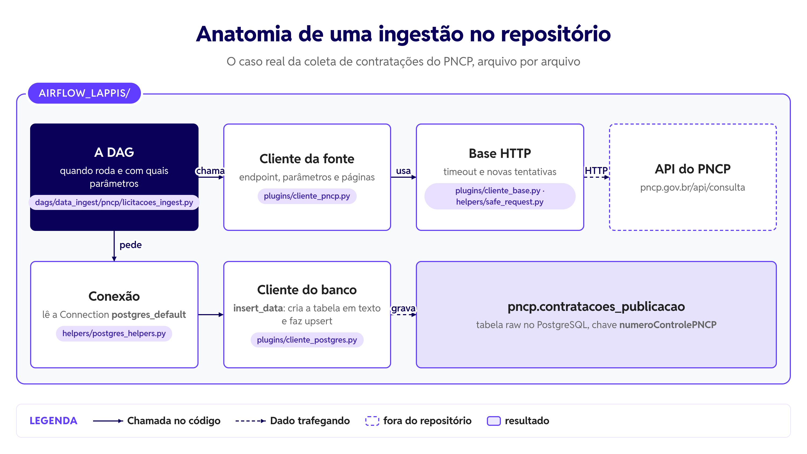

# Fontes e clientes do repositório

> Tipo: **Referência**

Mapa das fontes que a aplicação `data-application-gov-hub` coleta hoje, com o cliente e as DAGs de cada uma. Os caminhos são relativos a `airflow_lappis/`. Use esta página para achar um exemplo parecido com a fonte que você precisa integrar.

## Clientes por fonte

| Fonte | Como chega | Cliente | DAGs | Observação |
|---|---|---|---|---|
| PNCP (contratações públicas) | API REST, JSON, paginada, aberta | `plugins/cliente_pncp.py` (herda `ClienteBase`) | `dags/data_ingest/pncp/` | O caso usado nas práticas deste nível |
| Compras.gov (contratos) | API REST, JSON | `plugins/cliente_contratos.py` (herda `ClienteBase`) | `dags/data_ingest/compras_gov/` | Base `contratos.comprasnet.gov.br/api` |
| TransfereGov (TED) | API REST, JSON | `plugins/cliente_ted.py` (herda `ClienteBase`) | `dags/data_ingest/transfere_gov/` | Termos de execução descentralizada |
| SIORG (estrutura organizacional) | API REST, JSON | `plugins/cliente_siorg.py` (herda `ClienteBase`) | `dags/data_ingest/siorg/` | |
| IBGE | FTP com arquivos do Censo | `plugins/cliente_ibge.py` | `dags/data_ingest/ibge/` | Leitores de arquivo em `helpers/quilombolas_parser.py` |
| SIAFI | SOAP com XML, biblioteca `zeep` | `plugins/cliente_siafi.py` | `dags/data_ingest/siafi/` | Exige certificado ICP-Brasil (preparado no `Dockerfile`) |
| SIAPE | SOAP com XML | `plugins/cliente_siape.py` | `dags/data_ingest/siape/` | Dados de pessoal: atenção a dados pessoais |
| Tesouro Gerencial e SGAC | Relatórios em anexo de e-mail (CSV ou ZIP), por IMAP | `plugins/cliente_email.py` | `dags/data_ingest/tesouro_gerencial/`, `dags/data_ingest/sgac/` | No Tesouro Gerencial, `plugins/email_ingest_dag_factory.py` monta as DAGs a partir de uma configuração por relatório |
| Sistemas internos em SQL Server | Consulta a outro banco, `MsSqlHook` | `plugins/cliente_sqlserver.py` | `dags/data_ingest/sisbolsas/`, `dags/data_ingest/ipea_pro/` | Usa a Connection `mssql_default` |

## Peças comuns

| Peça | Arquivo | O que oferece |
|---|---|---|
| Base HTTP | `plugins/cliente_base.py` | `httpx.Client`, `DEFAULT_TIMEOUT = 10`, até 3 novas tentativas com espera crescente; **levanta exceção** ao esgotar |
| Pedido tolerante | `helpers/safe_request.py` | Aceita resposta vazia e não JSON; ao esgotar as tentativas **devolve `503` em vez de levantar** |
| Retentativa genérica | `helpers/retry_helpers.py` | Decorador para repetir funções |
| Conexão com o banco | `helpers/postgres_helpers.py` | `get_postgres_conn()` lê a Connection `postgres_default` |
| Gravação | `plugins/cliente_postgres.py` | `insert_data`: cria schema e tabela em `TEXT`, achata JSON com `__`, acrescenta colunas novas e faz upsert por `conflict_fields` |
| Agendamento | `plugins/schedule_loader.py` | `get_dynamic_schedule("nome_da_dag")`, lido da Variable `dynamic_schedules`; sem entrada, vale `@daily` |

## Perguntas para qualquer fonte nova

| Pergunta | Exemplo no PNCP |
|---|---|
| Como autentica? | Não autentica: API aberta |
| Como recorta o período? | `dataInicial` e `dataFinal` no formato `AAAAMMDD` |
| Como pagina e como saber o fim? | `pagina=N`; a resposta traz `totalPaginas` |
| Qual o limite de pedidos? | Responde `429 Too Many Requests` a pedidos seguidos; um por segundo funciona |
| Quanto demora? | Mais de 10 segundos em alguns pedidos: o tempo limite padrão não basta |
| Qual a chave de cada registro? | `numeroControlePNCP` |
| Que campos vêm vazios ou aninhados? | `valorTotalHomologado` nulo; `orgaoEntidade` e `unidadeOrgao` como objetos; `fontesOrcamentarias` como lista |
| Em que formato vêm os números? | Ponto decimal (`16505.36`), sem separador de milhar |

## Certificados e credenciais

- A cadeia ICP-Brasil é instalada no `Dockerfile`. Nunca desative a verificação de certificado para "resolver" um erro de conexão.
- Senhas, tokens e certificados privados vêm do `.env` (local) ou de Connections e Variables do Airflow. O `local.env` versionado só traz nomes e valores de exemplo.

## Veja também

- [Ingestão: trazer o dado da fonte para o banco](../explicacao/engenharia-ingestao.md)
- [Checklist: adicionar uma base nova](engenharia-checklist-base-nova.md)
