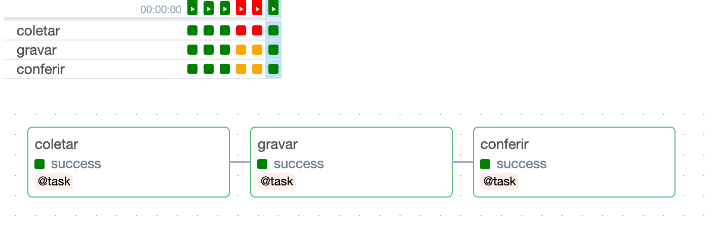
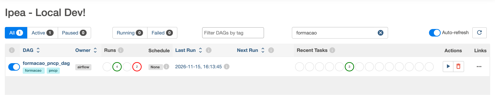
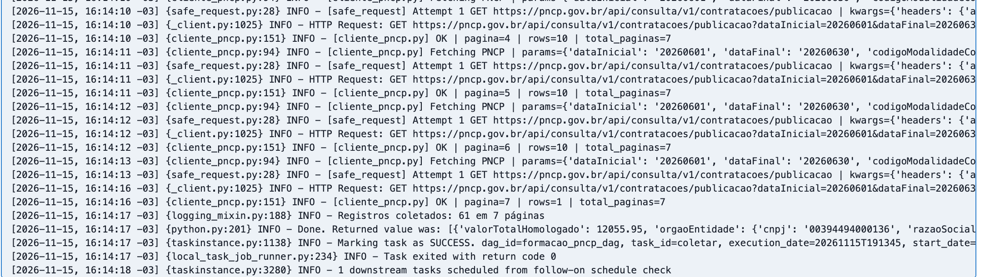
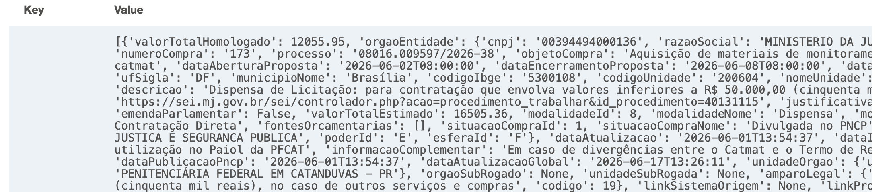
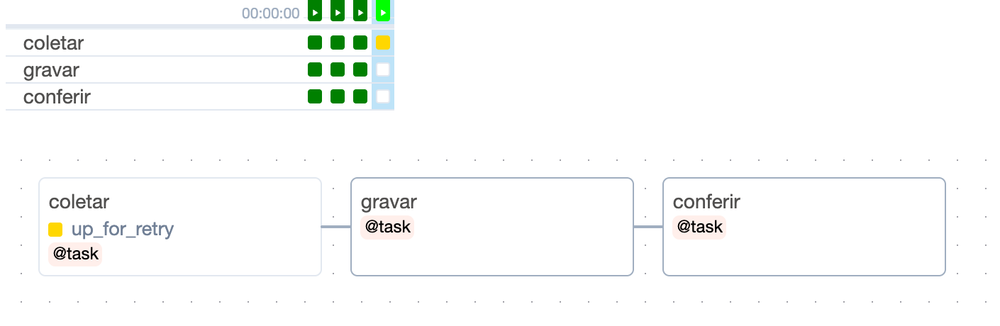
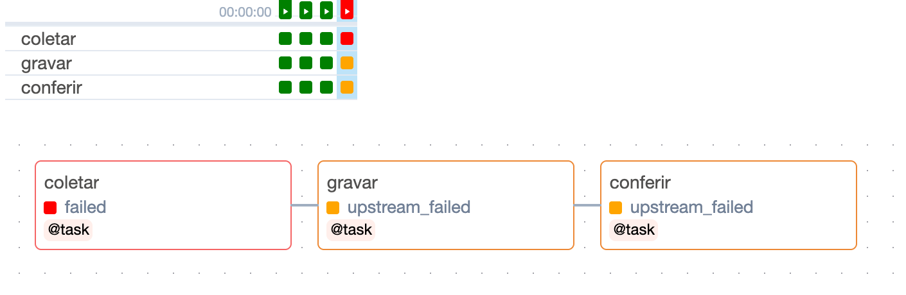
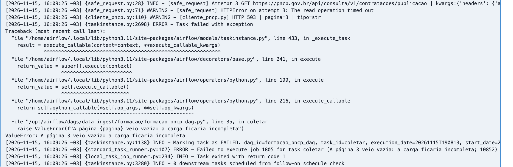

# Prática: orquestrar a coleta com o Airflow

> Tipo: **Tutorial**

## O que você vai construir

A coleta das duas práticas anteriores vira uma DAG do Airflow, com três tarefas: `coletar` busca as 7 páginas no PNCP, `gravar` usa o `insert_data` do repositório e `conferir` compara o que foi enviado com o que está no banco. Depois você vai quebrá-la de propósito para ver nova tentativa, falha e propagação na tela.



## O que você vai aprender

- Escrever uma DAG com `@dag` e `@task`, no padrão do repositório.
- Ler as telas Grid, Graph, Logs e XCom.
- Configurar tentativas e entender os estados `up_for_retry`, `failed` e `upstream_failed`.
- Proteger a DAG contra uma carga parcial que termina "com sucesso".

## Antes de começar

- Ambiente da aplicação no ar (`docker compose ps`) e configurado (`make dev-check`).
- Airflow em `http://localhost:8080`, com o usuário e a senha `_AIRFLOW_WWW_USER_*` do `.env`.
- Ter feito as práticas de [coleta](engenharia-coleta-python.md) e de [gravação](engenharia-ingestao-bancos.md).

## Passo 1: criar o arquivo da DAG

As DAGs de coleta ficam em `airflow_lappis/dags/data_ingest/<fonte>/`. Crie a pasta `formacao` e, nela, o arquivo `formacao_pncp_dag.py`:

```python
import time
from datetime import datetime, timedelta

from airflow.decorators import dag, task

from cliente_pncp import ClientePNCP
from cliente_postgres import ClientPostgresDB
from postgres_helpers import get_postgres_conn


@dag(
    schedule=None,
    start_date=datetime(2026, 1, 1),
    catchup=False,
    default_args={"retries": 2, "retry_delay": timedelta(minutes=2)},
    tags=["formacao", "pncp"],
)
def formacao_pncp_dag() -> None:
    """Coleta de estudo: dispensas publicadas no PNCP por um órgão em um mês."""

    @task
    def coletar() -> list[dict]:
        api = ClientePNCP()
        api.DEFAULT_TIMEOUT = 60
        registros: list[dict] = []
        pagina, total_paginas = 1, 1
        while pagina <= total_paginas:
            itens, total_paginas = api.get_contratacoes_publicacao(
                data_inicial="20260601",
                data_final="20260630",
                codigo_modalidade_contratacao=8,
                cnpj="00394494000136",
                pagina=pagina,
            )
            if not itens:
                raise ValueError(f"A página {pagina} veio vazia: a carga ficaria incompleta")
            registros.extend(itens)
            pagina += 1
            time.sleep(1)
        print(f"Registros coletados: {len(registros)} em {total_paginas} páginas")
        return registros

    @task
    def gravar(registros: list[dict]) -> int:
        db = ClientPostgresDB(get_postgres_conn())
        db.insert_data(
            registros,
            table_name="pncp_contratacoes",
            conflict_fields=["numeroControlePNCP"],
            primary_key=["numeroControlePNCP"],
            schema="formacao",
        )
        return len(registros)

    @task
    def conferir(enviados: int) -> None:
        db = ClientPostgresDB(get_postgres_conn())
        [(no_banco,)] = db.execute_query(
            "select count(*) from formacao.pncp_contratacoes"
        )
        print(f"Enviados: {enviados} | No banco: {no_banco}")
        if no_banco < enviados:
            raise ValueError("O banco tem menos linhas do que a coleta enviou")

    conferir(gravar(coletar()))


formacao_pncp_dag()
```

O que cada parte faz:

| Trecho | Papel |
|---|---|
| `from cliente_pncp import ...` | Os módulos de `plugins/` e `helpers/` já estão no caminho do Python do Airflow; por isso o import é direto |
| `schedule=None` | Só roda quando você mandar. Uma DAG real teria `"@daily"` ou usaria `get_dynamic_schedule` |
| `retries=2`, `retry_delay=2 min` | Até 3 tentativas por tarefa, com 2 minutos de espera |
| `api.DEFAULT_TIMEOUT = 60` | O PNCP pode levar mais de 10 s, o padrão da `ClienteBase` |
| O laço em `coletar` | Percorre as páginas e **falha** se uma vier vazia antes do fim (veja o passo 5) |
| `time.sleep(1)` | Um pedido por segundo, para não receber `429 Too Many Requests` |
| `conferir(gravar(coletar()))` | Define a ordem e passa os resultados entre as tarefas |

O nome da DAG é o nome da função: `formacao_pncp_dag`. Arquivos em `dags/` são lidos automaticamente; em até um minuto ela aparece na tela.

Este arquivo é de estudo. Não o inclua em um commit nem em um pull request.

## Passo 2: encontrar a DAG e disparar

Na tela inicial, busque por `formacao`:



Se a DAG não aparecer em dois minutos, procure um aviso vermelho de **Import Error** no topo da tela: é um erro de sintaxe ou de import no arquivo. O comando `docker compose exec airflow airflow dags list-import-errors` mostra o mesmo erro no terminal.

1. Ligue a DAG pelo botão à esquerda do nome (ela nasce pausada).
2. Clique no nome e depois em ▶ (**Trigger DAG**).
3. Abra a aba **Graph**. As caixas mudam de cor conforme as tarefas rodam: cinza (`queued`), verde-claro (`running`), verde (`success`). A coleta leva cerca de 40 segundos.

Se `coletar` ficar amarela (`up_for_retry`) e o log mostrar `HTTP 429`, a API do PNCP limitou os pedidos do seu endereço, o que acontece depois de várias execuções seguidas. Não mexa em nada: a nova tentativa, 2 minutos depois, costuma passar. É para isso que servem as `retries`.

## Passo 3: ler o log e o XCom

Clique na caixa `coletar` e abra **Logs**. Cada página aparece no log do cliente, e a última linha é a do seu `print`:



```text
[cliente_pncp.py] OK | pagina=7 | rows=1 | total_paginas=7
Registros coletados: 61 em 7 páginas
Done. Returned value was: [{'valorTotalHomologado': 12055.95, ...
```

Ainda em `coletar`, abra **XCom**. É ali que fica o valor devolvido pela tarefa: a lista com os 61 registros, que o Airflow entregou a `gravar`.



XCom fica guardado no banco do próprio Airflow. 61 registros cabem; 600 mil não caberiam. Para volumes grandes, a tarefa grava no PostgreSQL e passa adiante só o nome da tabela.

Por fim, o log de `conferir` deve terminar com:

```text
Enviados: 61 | No banco: 61
```

## Passo 4: conferir no banco

O estado verde diz que o código terminou sem exceção. Ele não diz que o dado está certo. Confira:

<!-- explica: Roda uma consulta no banco, pelo `psql` do container do PostgreSQL, que conta as linhas da tabela `formacao.pncp_contratacoes` e quantos valores diferentes a chave `numerocontrolepncp` tem. Números iguais querem dizer que nenhuma contratação foi gravada duas vezes. -->

```bash
docker compose exec postgres psql -U postgres -c "select count(*), count(distinct numerocontrolepncp) from formacao.pncp_contratacoes"
```

```text
 count | count
-------+-------
    61 |    61
```

Dispare a DAG mais uma vez. Continua 61: o `insert_data` faz upsert pela chave.

## Passo 5: quebrar de propósito

No arquivo, troque `api.DEFAULT_TIMEOUT = 60` por `api.DEFAULT_TIMEOUT = 1` e salve. Espere um minuto para o Airflow reler o arquivo e dispare de novo.

Com só 1 segundo, algumas páginas respondem a tempo e outras não. Quando uma página estoura o tempo nas 3 tentativas do `safe_request`, o cliente devolve uma lista vazia, e a sua verificação levanta o erro. A tarefa vai para **up_for_retry** (amarelo) e espera 2 minutos:



Quando as tentativas acabam, `coletar` fica **failed** e as seguintes ficam **upstream_failed**:



Abra o log de `coletar` e escolha a última tentativa no seletor **(by attempts)**. O log conta a história de baixo para cima:



```text
[safe_request] HTTPError on attempt 1: The read operation timed out
[safe_request] HTTPError on attempt 2: The read operation timed out
[safe_request] HTTPError on attempt 3: The read operation timed out
[cliente_pncp.py] HTTP 503 | pagina=3 | tipo=str
ValueError: A página 3 veio vazia: a carga ficaria incompleta
```

Investigue sempre pela **primeira tarefa vermelha** e, nela, pelo **primeiro erro** do log. `gravar` e `conferir` não têm defeito: só não puderam rodar.

Volte o tempo limite para 60, salve e espere a releitura. Na execução que falhou, clique em `coletar`, depois em **Clear task**, mantenha a opção **Downstream** marcada e confirme. O Airflow roda de novo `coletar` e as tarefas que dependem dela, na mesma execução.

## Por que não usar o método paginado do cliente

O `ClientePNCP` tem `get_contratacoes_publicacao_paginado`, que já percorre as páginas. Esta prática não o usa por um motivo que apareceu nos testes desta aula.

Quando um pedido falha nas 3 tentativas, o `safe_request` não levanta exceção: devolve `503`, e o cliente devolve uma lista vazia. O método paginado entende a lista vazia como "acabaram as páginas" e para. Com o tempo limite de 1 segundo, a página 1 respondeu, a página 2 estourou o tempo, e a DAG terminou **verde, com 10 registros em vez de 61**. Uma carga parcial, reportada como completa.

A verificação `if not itens: raise ValueError(...)` transforma esse silêncio em uma falha visível. É uma melhoria possível para o próprio cliente do repositório: uma boa primeira contribuição, com teste em `tests/test_plugins/`.

## Outras formas de rodar

| Forma | Quando usar |
|---|---|
| Botão ▶ na tela | Disparo manual, como nesta prática |
| `docker compose exec airflow airflow dags test formacao_pncp_dag 2026-06-30` | Rodar a DAG inteira no terminal, sem o agendador; é o comando sugerido no modelo de pull request. Se uma tarefa falhar, ele espera o `retry_delay` antes de tentar de novo |
| `schedule="@daily"` ou `get_dynamic_schedule("formacao_pncp_dag")` | Agendar de verdade. Com `get_dynamic_schedule`, o horário vem da Variable `dynamic_schedules` |

## O que você aprendeu

- Uma DAG é um arquivo Python em `dags/data_ingest/<fonte>/`; a ordem das tarefas vem de como você as chama.
- Verde quer dizer "o código não levantou exceção"; a conferência do dado é sua.
- Tentativas automáticas resolvem instabilidade passageira; uma falha persistente fica vermelha e bloqueia o que depende dela.
- Uma DAG deve falhar quando a carga está incompleta, mesmo que o cliente não reclame.

## Próximos passos

- [Prática: transformar com dbt, da raw à gold](engenharia-dbt-camadas.md)
- [Orquestração: quem roda o quê, quando e em que ordem](../explicacao/engenharia-orquestracao.md)
