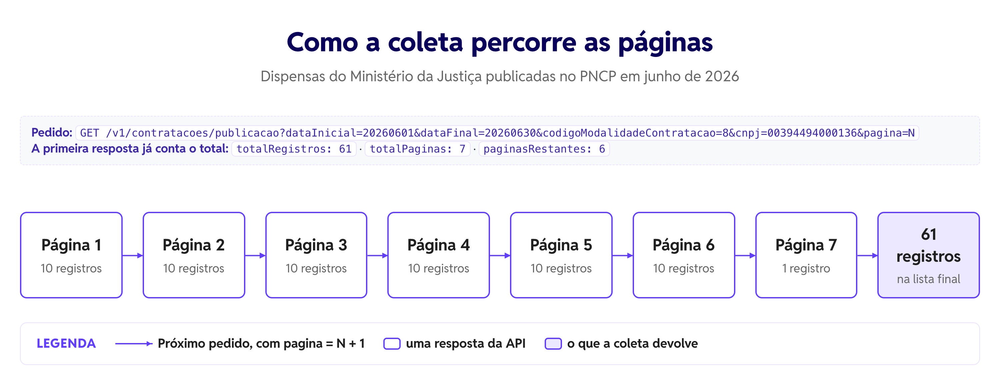

# Prática: coletar dados de uma API com Python

> Tipo: **Tutorial**

> Notebook: [engenharia-coleta-python.ipynb](../../notebooks/engenharia-coleta-python.ipynb)

## O que você vai construir

Uma coleta em Python que busca no PNCP as dispensas de licitação do Ministério da Justiça publicadas em junho de 2026: **61 registros em 7 páginas**. Ela percorre todas as páginas, espera e tenta de novo quando a API pede calma, falha de forma clara quando algo dá errado e salva o resultado em um arquivo JSON, que será a entrada da próxima prática.

## O que você vai aprender

- Fazer um pedido HTTP e ler a resposta JSON.
- Percorrer páginas até o fim informado pela API.
- Tratar tempo esgotado e `429 Too Many Requests` como problemas temporários, e um `4xx` como erro do pedido.
- Conferir a coleta antes de seguir.
- Reconhecer as mesmas ideias no cliente do repositório (`plugins/cliente_pncp.py`).

## Antes de começar

Use o Jupyter da aplicação, em `http://localhost:8888`. Se ele não estiver no ar, na raiz de `data-application-gov-hub` rode `docker compose up -d jupyter`. Crie um notebook na pasta `notebooks/`, que é a mesma pasta `notebooks/` do repositório no seu computador. Na primeira célula, instale o cliente HTTP:

```python
%pip install httpx
```

Os arquivos de estudo que você criar em `notebooks/` não fazem parte de uma contribuição: não os inclua em commits.

## Passo 1: fazer um pedido e ler a resposta

```python
import httpx

URL = "https://pncp.gov.br/api/consulta/v1/contratacoes/publicacao"
FILTRO = {
    "dataInicial": "20260601",
    "dataFinal": "20260630",
    "codigoModalidadeContratacao": 8,   # 8 = dispensa de licitação
    "cnpj": "00394494000136",           # Ministério da Justiça e Segurança Pública
}

resposta = httpx.get(URL, params={**FILTRO, "pagina": 1}, timeout=60)
print(resposta.status_code)
corpo = resposta.json()
print({chave: valor for chave, valor in corpo.items() if chave != "data"})
print(len(corpo["data"]))
```

Resultado esperado:

```text
200
{'totalRegistros': 61, 'totalPaginas': 7, 'numeroPagina': 1, 'paginasRestantes': 6, 'empty': False}
10
```

A resposta tem duas partes: `data`, com os registros desta página (10), e os campos de controle, que dizem quantos registros e páginas existem no total. A API do PNCP pode levar mais de 10 segundos para responder. Por isso o `timeout=60`: sem ele, o `httpx` desiste em 5 segundos.

Os números podem mudar um pouco se o órgão publicar ou corrigir registros depois desta aula. O raciocínio é o mesmo.

## Passo 2: olhar um registro

```python
primeiro = corpo["data"][0]
print(primeiro["numeroControlePNCP"], primeiro["valorTotalEstimado"])
print(primeiro["orgaoEntidade"]["razaoSocial"])
print(primeiro["unidadeOrgao"]["ufSigla"], primeiro["unidadeOrgao"]["nomeUnidade"])
```

```text
00394494000136-1-000543/2026 16505.36
MINISTERIO DA JUSTICA E SEGURANCA PUBLICA
DF PENITENCIÁRIA FEDERAL EM BRASILIA
```

Três observações que valem para qualquer fonte:

- **Chave:** `numeroControlePNCP` identifica cada contratação. É por ela que o banco vai evitar duplicatas.
- **Objetos dentro do registro:** `orgaoEntidade` e `unidadeOrgao` são dicionários. Na hora de gravar, eles viram colunas separadas.
- **Campos vazios:** `valorTotalHomologado` vem `None` quando a contratação ainda não foi homologada. Guarde isso: vai reaparecer na prática de dbt.

## Passo 3: percorrer todas as páginas, com nova tentativa

A coleta pede a página 1, lê `totalPaginas` e continua até a última. Cada pedido passa por uma função que separa dois tipos de problema:

- **Temporário:** tempo esgotado, `429 Too Many Requests` (a API pede para você ir mais devagar) e erros `5xx` do servidor. Vale esperar e tentar de novo.
- **Definitivo:** `400`, `401`, `404`, `422`. O pedido está errado; repetir não muda a resposta.



```python
import time

TEMPORARIOS = {429, 500, 502, 503, 504}


def pedir_pagina(cliente, filtro, pagina, tentativas=4):
    for tentativa in range(1, tentativas + 1):
        try:
            resposta = cliente.get(URL, params={**filtro, "pagina": pagina})
        except httpx.TimeoutException:
            motivo = "tempo esgotado"
        else:
            if resposta.status_code not in TEMPORARIOS:
                resposta.raise_for_status()   # 4xx: erro definitivo, sobe na hora
                return resposta.json()
            motivo = f"HTTP {resposta.status_code}"
        if tentativa == tentativas:
            raise RuntimeError(f"página {pagina}: {motivo} após {tentativas} tentativas")
        espera = 5 * tentativa
        print(f"página {pagina}: {motivo}; nova tentativa em {espera}s")
        time.sleep(espera)


def coletar(filtro, timeout=60):
    registros = []
    pagina, total_paginas = 1, 1
    with httpx.Client(timeout=timeout) as cliente:
        while pagina <= total_paginas:
            corpo = pedir_pagina(cliente, filtro, pagina)
            total_paginas = corpo["totalPaginas"]
            registros.extend(corpo["data"])
            print(f"página {pagina}/{total_paginas}: {len(corpo['data'])} registros")
            pagina += 1
            time.sleep(1)   # gentileza com a API: um pedido por segundo
    return registros


registros = coletar(FILTRO)
print(len(registros))
```

Resultado esperado (as linhas de "nova tentativa" só aparecem se a API pedir calma):

```text
página 1/7: 10 registros
página 2/7: 10 registros
página 3/7: 10 registros
página 4/7: 10 registros
página 5: HTTP 429; nova tentativa em 5s
página 5/7: 10 registros
página 6/7: 10 registros
página 7/7: 1 registros
61
```

O critério de parada vem da própria API (`totalPaginas`), e não de "a página veio com menos de 10". Cada fonte tem o seu: leia a documentação e confira na primeira resposta.

## Passo 4: provocar as duas falhas

Uma coleta bem feita falha **de forma visível**. Provoque um tempo esgotado com um limite impossível de cumprir (um centésimo de segundo):

```python
try:
    with httpx.Client(timeout=0.01) as cliente:
        pedir_pagina(cliente, FILTRO, 1, tentativas=2)
except RuntimeError as erro:
    print("falhou:", erro)
```

```text
página 1: tempo esgotado; nova tentativa em 5s
falhou: página 1: tempo esgotado após 2 tentativas
```

Agora um erro definitivo: a data no formato errado.

```python
try:
    with httpx.Client(timeout=60) as cliente:
        pedir_pagina(cliente, {**FILTRO, "dataInicial": "2026-06-01"}, 1)
except httpx.HTTPStatusError as erro:
    print("erro definitivo:", erro.response.status_code)
```

```text
erro definitivo: 422
```

O PNCP responde `422 Unprocessable Entity`: entendeu o pedido, mas o parâmetro é inválido. Como todo `4xx`, ele sobe na primeira tentativa, sem espera: repetir um pedido errado só gasta o limite da API.

## Passo 5: conferir e salvar

Antes de entregar a coleta para a próxima etapa, confira duas coisas: se veio tudo e se nada veio repetido.

```python
import json

ids = {r["numeroControlePNCP"] for r in registros}
assert len(registros) == corpo["totalRegistros"], "faltam registros"
assert len(ids) == len(registros), "há registros repetidos"

with open("pncp_dispensas_2026_06.json", "w", encoding="utf-8") as arquivo:
    json.dump(registros, arquivo, ensure_ascii=False)
print("salvo", len(registros))
```

```text
salvo 61
```

O arquivo fica em `notebooks/pncp_dispensas_2026_06.json`. A próxima prática começa por ele.

## Passo 6: encontrar as mesmas ideias no repositório

Abra `airflow_lappis/plugins/cliente_pncp.py` e `airflow_lappis/plugins/cliente_base.py`. Compare com o que você escreveu:

| No seu notebook | No repositório |
|---|---|
| `httpx.Client(timeout=60)` | `ClienteBase` cria um `httpx.Client` com `DEFAULT_TIMEOUT = 10` |
| `pedir_pagina` com tentativas e espera | `helpers/safe_request.py`: até 3 tentativas, espera crescente |
| Laço até `totalPaginas` | `ClientePNCP.get_contratacoes_publicacao_paginado` |
| `assert` de quantidade | Fica a cargo da DAG (você vai fazer isso na prática do Airflow) |

Há uma diferença importante. Quando as tentativas acabam, o `safe_request` **não levanta erro**: devolve o status `503`, e o `ClientePNCP` devolve uma lista vazia. O método paginado entende a lista vazia como "acabaram as páginas" e para. Resultado: uma coleta interrompida na página 2 termina "com sucesso" e com 10 registros em vez de 61. Na prática do Airflow, você vai ver isso acontecer e proteger a DAG contra esse caso.

## O que você aprendeu

- Uma coleta é um laço de pedidos guiado pelo que a própria API informa.
- Tempo limite, nova tentativa com espera e separação entre erro temporário e definitivo são partes da coleta, não extras.
- Conferir quantidade e chave antes de seguir evita que uma carga parcial passe como completa.

## Próximos passos

- [Prática: gravar a coleta em bancos de dados](engenharia-ingestao-bancos.md)
- [Ingestão: trazer o dado da fonte para o banco](../explicacao/engenharia-ingestao.md)
