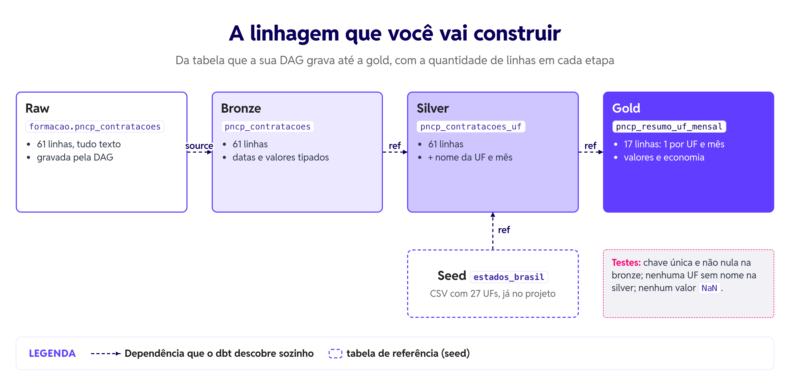
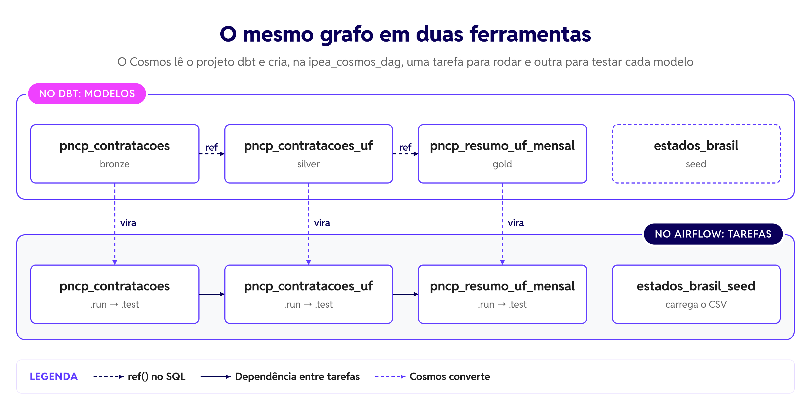

# Prática: transformar com dbt, da raw à gold

> Tipo: **Tutorial**

## O que você vai construir

Três modelos dbt sobre a tabela que a sua DAG gravou, `formacao.pncp_contratacoes`: uma bronze que corrige tipos, uma silver que traz o nome da UF de uma seed e uma gold com **valor estimado, valor homologado e economia por UF e mês**. No caminho, todos os testes vão passar e a gold vai sair errada, e você vai descobrir por quê.



## O que você vai aprender

- Declarar uma fonte com `source()` e ligar modelos com `ref()`.
- Configurar uma pasta de modelos no `dbt_project.yml`.
- Escrever os testes antes do SQL e rodar tudo com `dbt build`.
- Investigar um resultado estranho até a primeira etapa em que ele aparece.
- Escrever um teste próprio (singular) para o problema encontrado.

## Antes de começar

- A [prática do Airflow](engenharia-airflow-dag.md) concluída: `formacao.pncp_contratacoes` com 61 linhas.
- Os arquivos desta prática ficam no projeto dbt da aplicação, `airflow_lappis/dags/dbt/ipea/`. São arquivos de estudo: não entram em commit.

## Passo 0: preparar o terminal do dbt

O dbt da aplicação está instalado no container do Airflow. Na raiz de `data-application-gov-hub`, crie o papel somente leitura que o projeto usa nos `grants` (só na primeira vez) e entre no container:

```bash
make setup-roles
```

```bash
docker compose exec airflow bash
```

Dentro do container:

```bash
cd /opt/airflow/dags/dbt/ipea
export DB_DW_USER=$POSTGRES_USER DB_DW_PASSWORD=$POSTGRES_PASSWORD DB_DW_DBNAME=$POSTGRES_DB
dbt debug
```

```text
Connection test: [OK connection ok]
All checks passed!
```

Por que o `export`: o `profiles.yml` do projeto lê o banco das variáveis `DB_DW_*`, que apontam para o data warehouse de produção. No ambiente local, o banco é o mesmo `postgres` em que a DAG gravou, e o `export` diz isso ao dbt nesta sessão do terminal. Sem ele, o `dbt debug` falha com `password authentication failed for user "postgres_dw"`.

Se você seguiu [Executar o dbt e conferir os dados no banco](../guias/engenharia-dbt-configuracao.md), no nível 2, e roda o dbt pelo terminal do computador com o `profiles.yml` ajustado, pode usar esse terminal: o `export` não é necessário, e o restante da prática é igual.

## Passo 1: declarar a fonte

Crie `models/formacao_dbt/sources.yml`:

```yaml
version: 2

sources:
  - name: formacao
    schema: formacao
    tables:
      - name: pncp_contratacoes
        description: Contratações publicadas no PNCP, como chegaram da API (tudo em texto).
```

Isso não cria nada no banco: só dá ao dbt um nome para a tabela que a ingestão já gravou. A partir daqui, os modelos a leem com `{{ source("formacao", "pncp_contratacoes") }}`. Nas fontes reais, a declaração vai no `models/sources.yml` compartilhado.

## Passo 2: configurar a pasta

No `dbt_project.yml`, dentro de `models: ipea:`, junto dos outros domínios (`contratos_dbt`, `ted_dbt`...), acrescente:

```yaml
    formacao_dbt:
      +database: "{{ target.dbname }}"
      +materialized: table
      +schema: formacao_dw
```

Todo modelo em `models/formacao_dbt/` vira **tabela** no schema **`formacao_dw`**. É assim que os domínios reais são configurados.

A linha `+database` é só para o ambiente local. O projeto define `+database: analytics_ipea` para todos os modelos, o nome do banco de produção. No PostgreSQL, uma consulta não pode juntar tabelas de bancos diferentes, e localmente tudo está no banco `postgres`. A linha faz os modelos desta pasta irem para o banco da conexão atual.

## Passo 3: escrever o contrato antes do SQL

Antes de escrever o SQL, descreva o que precisa ser verdade em cada modelo. Crie `models/formacao_dbt/schema.yml`:

```yaml
version: 2

models:
  - name: pncp_contratacoes
    description: Bronze. Uma linha por contratação, com nomes e tipos corrigidos.
    columns:
      - name: numero_controle_pncp
        description: Identificador da contratação no PNCP.
        data_tests:
          - not_null
          - unique
      - name: valor_estimado
        data_tests:
          - not_null

  - name: pncp_contratacoes_uf
    description: Silver. Uma linha por contratação, com o nome da UF e o mês de referência.
    columns:
      - name: numero_controle_pncp
        data_tests:
          - unique
      - name: nome_uf
        data_tests:
          - not_null

  - name: pncp_resumo_uf_mensal
    description: Gold. Uma linha por UF e mês, com quantidade, valores e economia.
    columns:
      - name: uf_sigla
        data_tests:
          - not_null
```

Cada teste é uma frase sobre o resultado: "toda contratação tem número e ele não se repete", "a silver continua com uma linha por contratação", "toda UF encontrou o seu nome". O guia de pipeline da aplicação pede essa ordem, testes antes do modelo, em toda fonte nova.

## Passo 4: a bronze

Crie `models/formacao_dbt/bronze/pncp_contratacoes.sql`:

```sql
{{ config(materialized="table") }}

select
    numerocontrolepncp as numero_controle_pncp,
    orgaoentidade__cnpj as orgao_cnpj,
    orgaoentidade__razaosocial as orgao_nome,
    unidadeorgao__codigounidade as unidade_codigo,
    unidadeorgao__nomeunidade as unidade_nome,
    unidadeorgao__ufsigla as uf_sigla,
    modalidadenome as modalidade,
    situacaocompranome as situacao,
    objetocompra as objeto,
    cast(datapublicacaopncp as timestamp) as data_publicacao,
    cast(valortotalestimado as numeric(15, 2)) as valor_estimado,
    cast(valortotalhomologado as numeric(15, 2)) as valor_homologado
from {{ source("formacao", "pncp_contratacoes") }}
```

Só o que é permitido na bronze: escolher colunas, dar nomes claros e converter tipos. Nenhum filtro, nenhuma regra. Os nomes da esquerda são os que o `insert_data` criou: minúsculas, com `__` no lugar dos objetos internos.

## Passo 5: a silver, com uma seed

O projeto já tem a seed `seeds/estados_brasil.csv`, com as 27 UFs:

```text
sigla_uf,nome_uf
AC,ACRE
AL,ALAGOAS
```

Crie `models/formacao_dbt/silver/pncp_contratacoes_uf.sql`:

```sql
select
    c.numero_controle_pncp,
    c.orgao_nome,
    c.unidade_nome,
    c.uf_sigla,
    e.nome_uf,
    c.modalidade,
    date_trunc('month', c.data_publicacao)::date as mes_referencia,
    c.valor_estimado,
    c.valor_homologado
from {{ ref("pncp_contratacoes") }} as c
left join {{ ref("estados_brasil") }} as e on e.sigla_uf = c.uf_sigla
```

`ref()` funciona igual para modelos e seeds. A junção tem uma correspondência por UF; por isso a silver continua com uma linha por contratação, e o teste `unique` da silver confere exatamente isso. Uma seed com uma UF repetida duplicaria linhas, e esse teste reprovaria.

## Passo 6: a gold

Crie `models/formacao_dbt/gold/pncp_resumo_uf_mensal.sql`:

```sql
select
    uf_sigla,
    nome_uf,
    mes_referencia,
    count(*) as contratacoes,
    count(valor_homologado) as contratacoes_homologadas,
    sum(valor_estimado) as valor_estimado,
    sum(valor_homologado) as valor_homologado,
    sum(valor_estimado - valor_homologado) as economia
from {{ ref("pncp_contratacoes_uf") }}
group by uf_sigla, nome_uf, mes_referencia
```

`economia` soma `estimado - homologado` linha a linha. Onde o homologado é nulo, a subtração é nula e a linha fica de fora da soma: só há economia onde há os dois valores.

## Passo 7: rodar tudo

```bash
dbt build --select +pncp_resumo_uf_mensal --no-populate-cache
```

`+` antes do nome seleciona o modelo **e tudo de que ele depende**: a seed, a bronze e a silver. `build` roda cada um e, logo depois, os testes dele. `--no-populate-cache` evita que o dbt consulte, antes de começar, os bancos de produção configurados para outros modelos do projeto, o que no ambiente local termina em `Cross-db references not allowed`.

```text
1 of 10 OK created sql table model formacao_dw.pncp_contratacoes ......... [SELECT 61]
2 of 10 OK loaded seed file ipea.estados_brasil .......................... [INSERT 27]
3 of 10 PASS not_null_pncp_contratacoes_numero_controle_pncp ............. [PASS]
4 of 10 PASS not_null_pncp_contratacoes_valor_estimado ................... [PASS]
5 of 10 PASS unique_pncp_contratacoes_numero_controle_pncp ............... [PASS]
6 of 10 OK created sql table model formacao_dw.pncp_contratacoes_uf ...... [SELECT 61]
7 of 10 PASS not_null_pncp_contratacoes_uf_nome_uf ....................... [PASS]
8 of 10 PASS unique_pncp_contratacoes_uf_numero_controle_pncp ............ [PASS]
9 of 10 OK created sql table model formacao_dw.pncp_resumo_uf_mensal ..... [SELECT 17]
10 of 10 PASS not_null_pncp_resumo_uf_mensal_uf_sigla .................... [PASS]
Done. PASS=12 WARN=0 ERROR=0
```

A ordem não veio da ordem dos arquivos: o dbt descobriu pelos `ref()` que a bronze e a seed vêm antes da silver, e a silver antes da gold. Tudo verde.

## Passo 8: olhar a gold de verdade

Testes verdes não dispensam olhar o resultado. Fora do container (ou em outro terminal):

```bash
docker compose exec postgres psql -U postgres -c "select uf_sigla, contratacoes, contratacoes_homologadas, valor_estimado, valor_homologado, economia from formacao_dw.pncp_resumo_uf_mensal order by uf_sigla limit 5"
```

```text
 uf_sigla | contratacoes | contratacoes_homologadas | valor_estimado | valor_homologado | economia
----------+--------------+--------------------------+----------------+------------------+----------
 AC       |            2 |                        2 |       23383.16 |              NaN |      NaN
 AM       |            1 |                        1 |      105900.00 |        105900.00 |     0.00
 BA       |            1 |                        1 |        1375.00 |              NaN |      NaN
 DF       |           13 |                       13 |     3294941.07 |              NaN |      NaN
 ES       |            1 |                        1 |       51000.00 |         29000.00 | 22000.00
```

`NaN` (*not a number*) não é nulo: é um valor numérico especial, e qualquer conta com ele dá `NaN`. Um painel em cima desta gold mostraria campos vazios ou erro, e `contratacoes_homologadas` também está errado, porque conta o `NaN` como valor presente.

## Passo 9: encontrar a primeira etapa com o problema

A regra de investigação é voltar pela linhagem até a **primeira** etapa em que o problema aparece. A gold só soma; a silver só repassa o valor; a bronze converte o texto. Olhe a raw:

```bash
docker compose exec postgres psql -U postgres -c "select numerocontrolepncp, valortotalhomologado from formacao.pncp_contratacoes where valortotalhomologado = 'NaN' limit 3"
```

```text
      numerocontrolepncp      | valortotalhomologado
------------------------------+----------------------
 00394494000136-1-000553/2026 | NaN
 00394494000136-1-000557/2026 | NaN
 00394494000136-1-000574/2026 | NaN
```

São as 8 contratações sem valor homologado que você viu na prática de gravação. A API manda `null`; o `insert_data` usa `pandas.json_normalize`, que transforma `None` em `NaN`; e a coluna `TEXT` guarda o texto `'NaN'`. A raw está fazendo o papel dela: guardar o que recebeu. Quem deve interpretar isso é a bronze, e o `cast` interpretou `'NaN'` literalmente.

## Passo 10: escrever o teste que faltou

Antes de corrigir, escreva um teste que pegue o problema, para que ele não volte sem aviso. Um **teste singular** é um `select` que deve voltar vazio. Crie `tests/formacao/assert_pncp_sem_nan.sql`, na pasta `tests/` do projeto dbt:

```sql
-- Falha se algum valor virou NaN no caminho entre a API e a bronze.
select numero_controle_pncp, valor_estimado, valor_homologado
from {{ ref("pncp_contratacoes") }}
where valor_estimado = 'NaN'::numeric or valor_homologado = 'NaN'::numeric
```

```bash
dbt test --select assert_pncp_sem_nan --no-populate-cache
```

```text
1 of 1 FAIL 8 assert_pncp_sem_nan ......................................... [FAIL 8]
  Got 8 results, configured to fail if != 0
```

O teste reprova com as 8 linhas que você já conhecia.

## Passo 11: corrigir na bronze e rodar de novo

Na bronze, trate o texto `'NaN'` como ausência de valor:

```sql
    cast(nullif(valortotalestimado, 'NaN') as numeric(15, 2)) as valor_estimado,
    cast(nullif(valortotalhomologado, 'NaN') as numeric(15, 2)) as valor_homologado
```

`nullif(a, b)` devolve nulo quando `a = b`. Agora reconstrua a bronze e tudo que vem depois dela:

```bash
dbt build --select pncp_contratacoes+ --no-populate-cache
```

```text
2 of 10 PASS assert_pncp_sem_nan ......................................... [PASS]
Done. PASS=12 WARN=0 ERROR=0
```

`+` **depois** do nome seleciona os descendentes: bronze, silver, gold e os testes de cada uma. A gold agora:

| uf_sigla | nome_uf | contratacoes | homologadas | valor_estimado | valor_homologado | economia |
|---|---|---|---|---|---|---|
| SC | SANTA CATARINA | 4 | 4 | 179.185,95 | 130.763,95 | 48.422,00 |
| DF | DISTRITO FEDERAL | 13 | 12 | 3.294.941,07 | 3.206.150,23 | 42.110,84 |
| RS | RIO GRANDE DO SUL | 3 | 2 | 110.680,00 | 48.630,00 | 39.160,00 |

No total, 61 contratações, 53 homologadas e R$ 206.820,23 de economia. O DF passou de 13 para 12 homologadas: o `NaN` estava sendo contado como valor.

O repositório já conhecia esse problema: a macro `macros/parse_financial_value.sql` trata `'%NaN%'` e vazios. Ela não serve aqui porque também remove pontos de milhar (`1.234,56`), e o PNCP manda o ponto como separador decimal (`16505.36`). Conhecer o formato da fonte vem antes de reaproveitar uma macro.

## Passo 12: ver os modelos no Airflow

Em produção, ninguém roda `dbt build` à mão. A DAG `ipea_cosmos_dag` (`dags/dbt/ipea/cosmos_dag.py`) roda o projeto todo dia à 01:00. Ela usa o **Cosmos**, que lê o projeto dbt e cria uma tarefa para cada modelo e cada seed. Seus modelos já fazem parte dela. Confira no terminal do container:

```bash
airflow tasks list ipea_cosmos_dag | grep -E "pncp|estados"
```

```text
estados_brasil_seed
pncp_contratacoes.run
pncp_contratacoes.test
pncp_contratacoes_uf.run
pncp_contratacoes_uf.test
pncp_resumo_uf_mensal.run
pncp_resumo_uf_mensal.test
```



Não dispare a `ipea_cosmos_dag` localmente: ela roda os mais de 130 modelos do projeto e precisa das variáveis `DB_DW_*` configuradas no `.env`, não só no seu terminal.

## Limpar o estudo

Os arquivos desta prática e da prática do Airflow são de estudo. Antes de qualquer trabalho de verdade no repositório, confira com `git status` e descarte-os:

```text
airflow_lappis/dags/data_ingest/formacao/
airflow_lappis/dags/dbt/ipea/models/formacao_dbt/
airflow_lappis/dags/dbt/ipea/tests/formacao/
alteração em airflow_lappis/dags/dbt/ipea/dbt_project.yml
```

As tabelas dos schemas `formacao` e `formacao_dw` podem ficar no banco local ou ser removidas com `drop schema ... cascade`.

## O que você aprendeu

- `source()` lê a raw; `ref()` liga modelos e seeds e define a ordem; `+` amplia a seleção para antes ou para depois.
- A pasta e o `dbt_project.yml` decidem schema e materialização.
- Testes verdes não garantem um resultado certo: olhe a gold e volte pela linhagem até a primeira etapa com o problema.
- Cada problema encontrado vira um teste, para não voltar em silêncio.

## Próximos passos

- [Guia: adicionar uma fonte nova ao repositório](../guias/engenharia-fonte-nova.md)
- [Transformação: da raw à gold com SQL versionado](../explicacao/engenharia-transformacao.md)
