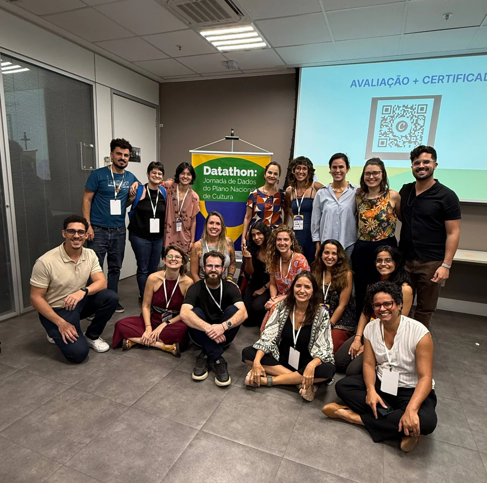Datathon reúne 104 participantes de 35 organizações para construir soluções de monitoramento do Plano Nacional de Cultura

A Jornada de Dados do Plano Nacional de Cultura foi promovida pelo Gov Hub em parceria com o Ministério da Cultura.

Brasília, 9 e 10 de setembro

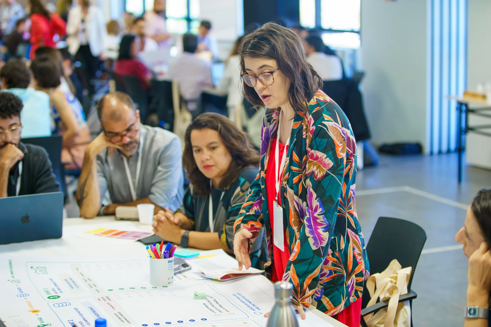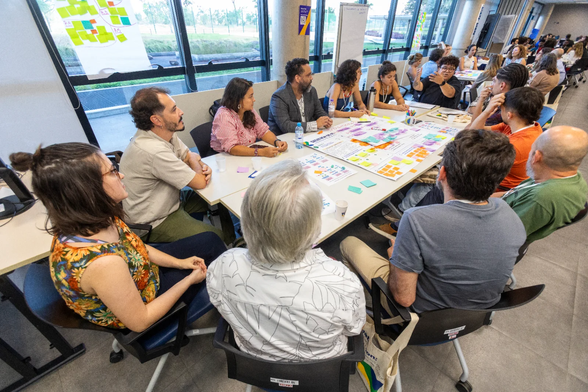

Nos dias 9 e 10 de setembro, aconteceu em Brasília o Datathon, a nossa "Jornada de Dados do Plano Nacional de Cultura". O evento foi promovido pelo Gov Hub em parceria com o Ministério da Cultura.

O encontro reuniu 104 participantes de 35 organizações da sociedade civil que toparam o desafio de construir, de forma coletiva, soluções para os desafios de monitorar as metas do Plano Nacional de Cultura (PNC). A ideia central foi fortalecer a rede de quem gera, qualifica e utiliza esses dados.

O trabalho seguiu quatro etapas, cada uma guiada por uma pergunta:

Na primeira, os grupos discutiram o sentido de cada meta do PNC: o que motivou essa meta e que resultado ela busca.

Na segunda, mapearam quais dados já existem hoje. Avaliaram também se esses dados servem para acompanhar o Plano, ou se é preciso criar novos, e por quem.

Na terceira, propuseram indicadores possíveis, mensuráveis e viáveis de manter atualizados.

Na quarta, cada organização pensou em como pode se envolver no monitoramento do novo PNC.

Esse processo também ajudou a estruturar e fortalecer a rede de produtores e curadores de dados do setor da cultura no Brasil. Essa estrutura reúne o governo, a sociedade civil, a academia e outros parceiros do Sistema Nacional de Informações e Indicadores Culturais (SNIIC). O próximo passo é transformar esse trabalho em recomendações práticas, com responsáveis definidos para a coleta, a integração e a transparência dos dados.

O Gov Hub trabalha com integração de dados públicos, e ter a oportunidade de participar dessa construção coletiva em prol do PNC reforça a qualidade da metodologia desenvolvida internamente e aproxima os ganhos empíricos de outras experiências de monitoramento baseadas em dados.

Fotos do Datathon

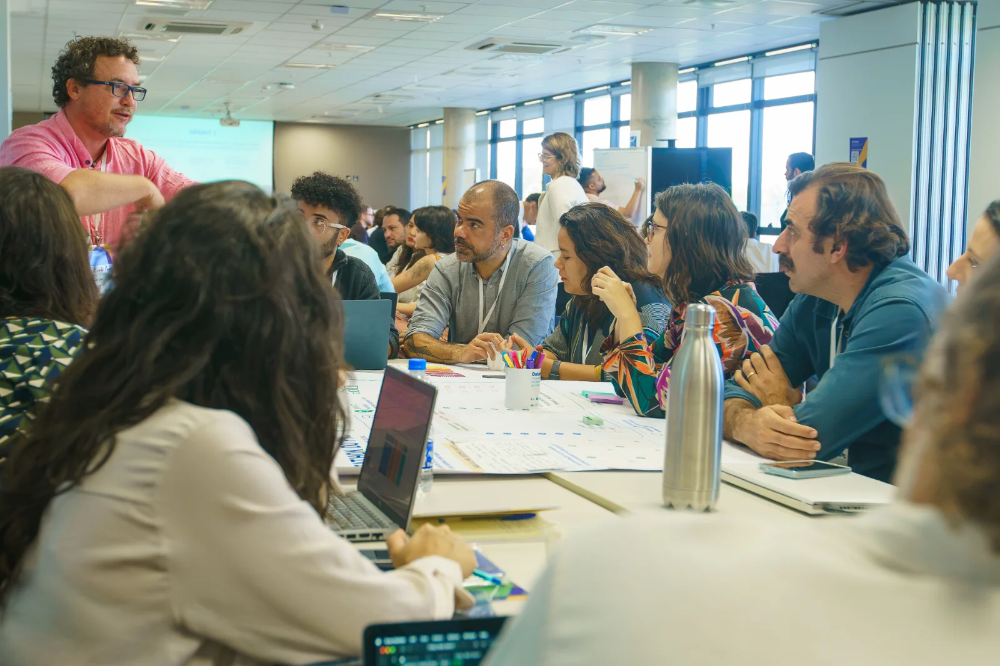

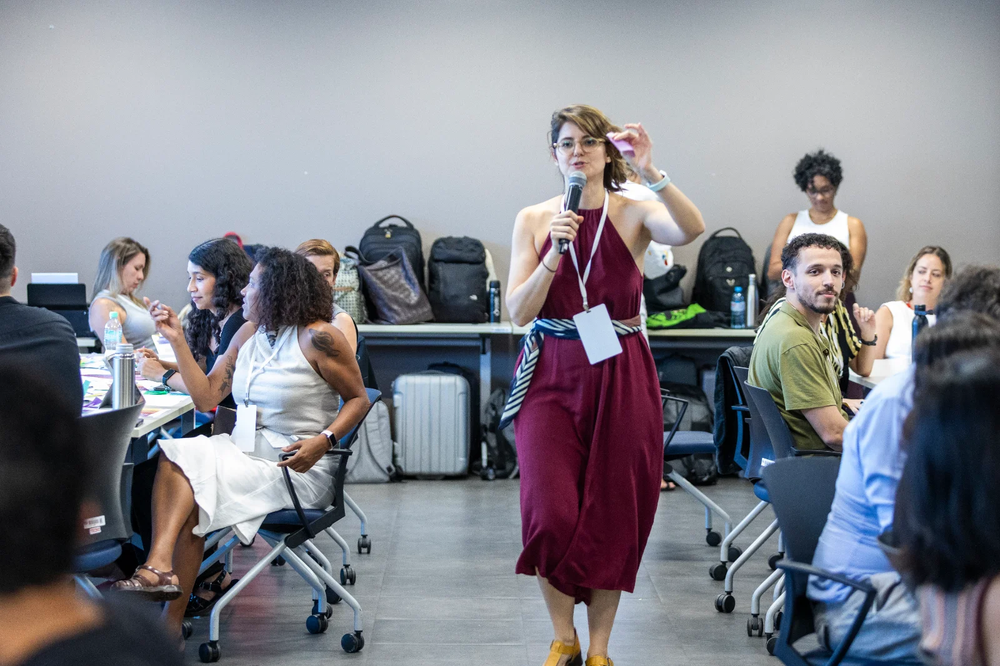

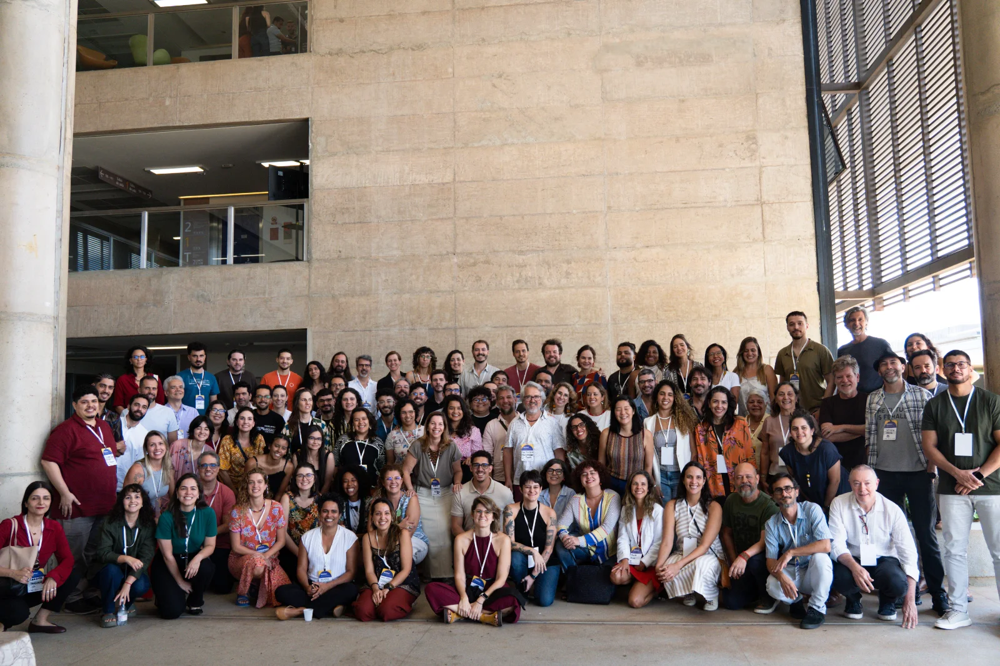

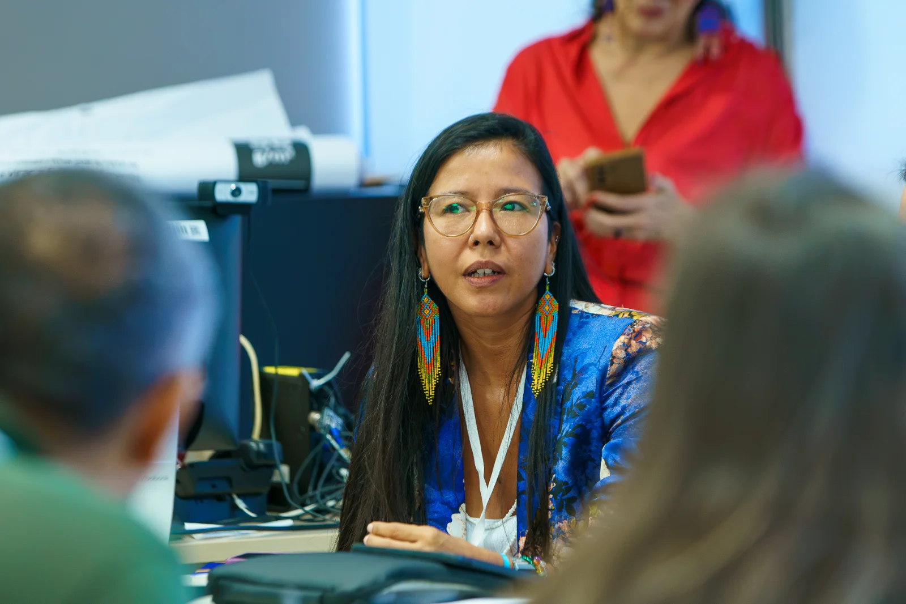

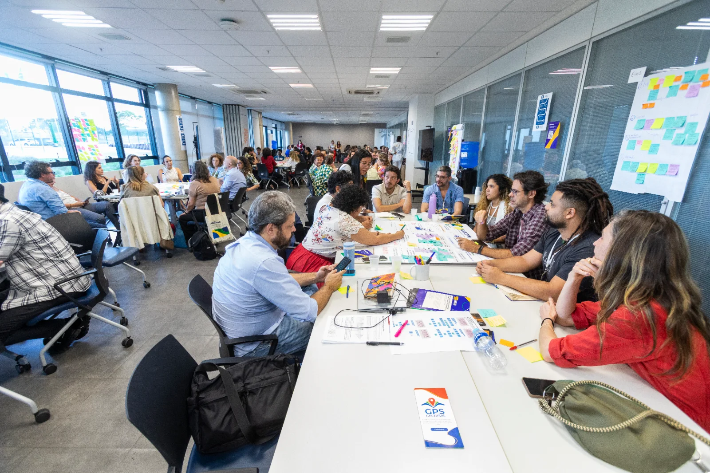

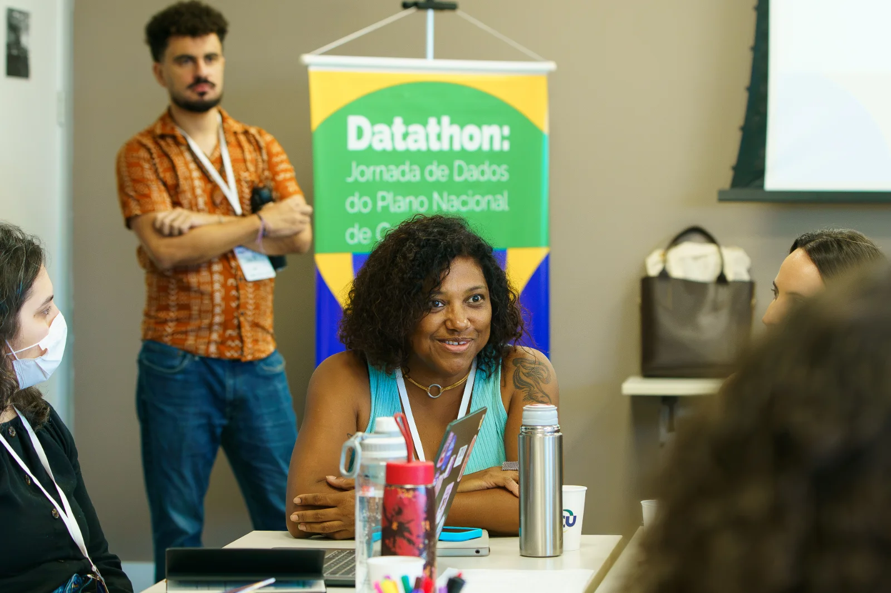

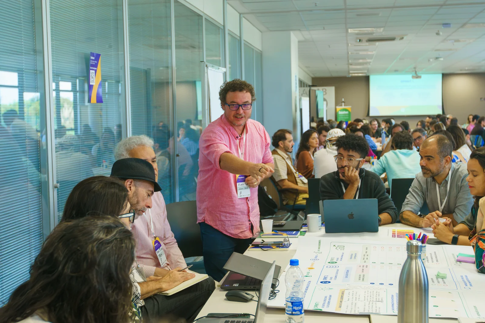

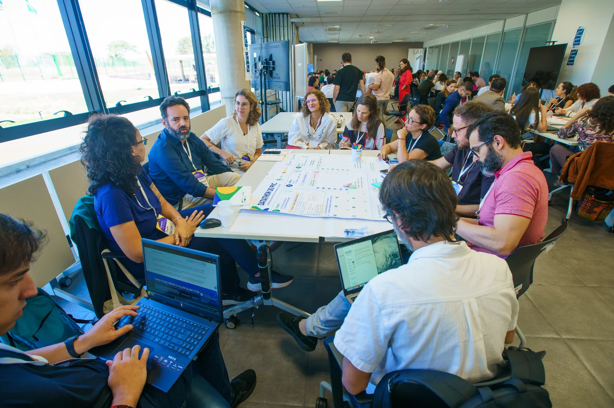

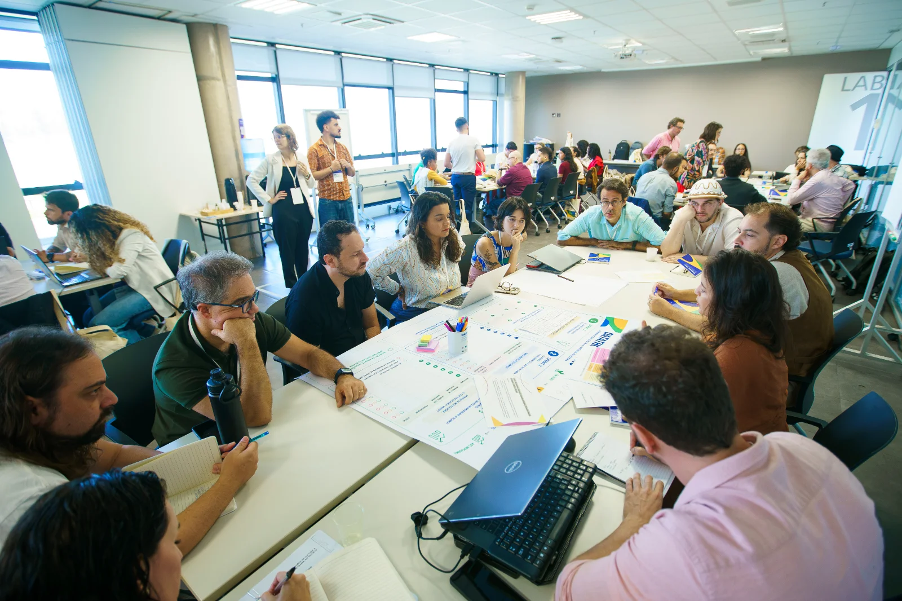
