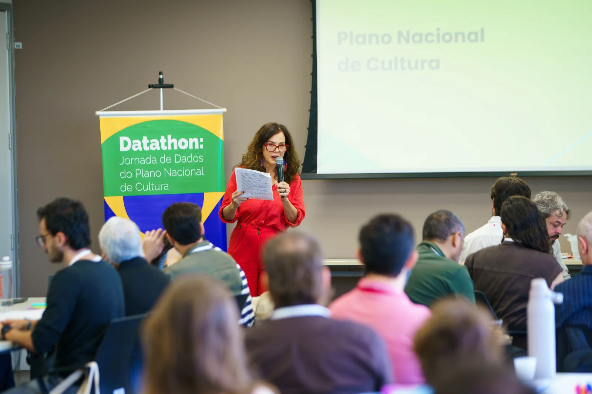
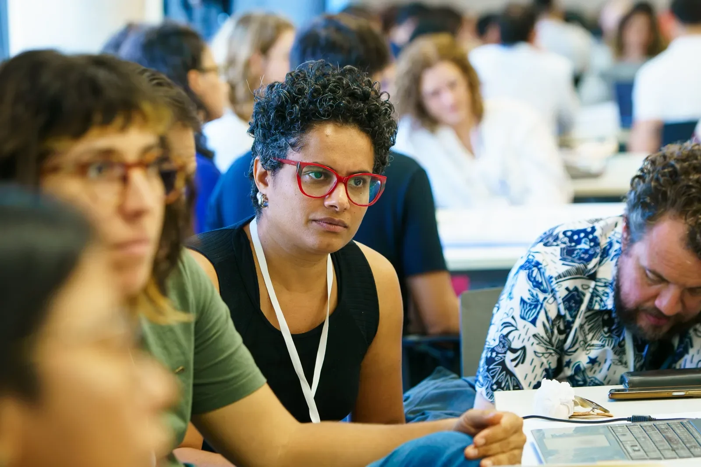

<!doctype html>
<html lang="pt-BR">
<head>
<meta charset="utf-8">
<meta name="viewport" content="width=device-width, initial-scale=1">
<title>Datathon: Jornada de Dados do PNC | Gov Hub</title>
<meta name="description" content="Nos dias 9 e 10 de setembro, em Brasília, 104 pessoas de 35 organizações da sociedade civil construíram coletivamente soluções para monitorar as metas do Plano Nacional de Cultura.">

</head>
<body>

<!-- HERO -->
<header class="hero">

  

    

      
      Em parceria com o Ministério da Cultura
    

    

      9 e 10 de setembro · Brasília
      <h1>Datathon: Jornada de Dados do Plano Nacional de Cultura</h1>
      
Dois dias de trabalho coletivo para construir, com a sociedade civil, soluções para monitorar as metas do PNC.

      

        104 participantes
        35 organizações
        4 etapas
      

    

  

  <figure class="hero-photo">
    
    <figcaption>Participantes do Datathon reunidos em Brasília.</figcaption>
  </figure>
  

</header>

<!-- NÚMEROS -->
<section class="stats" aria-label="O Datathon em números">
  

    

      

104

participantes

      

35

organizações da sociedade civil

      

2

dias de trabalho em Brasília

      

4

etapas, cada uma guiada por uma pergunta

    

  

</section>

<!-- O QUE FOI -->
<section class="sec" id="o-evento">
  

    

      O encontro
      <h2>Construir juntos como acompanhar o PNC</h2>
      
Nos dias 9 e 10 de setembro, aconteceu em Brasília o <strong>Datathon</strong>, a nossa “Jornada de Dados do Plano Nacional de Cultura”. O evento foi promovido pelo <strong>Gov Hub</strong> em parceria com o <strong>Ministério da Cultura</strong>.

      
O encontro reuniu 104 participantes de 35 organizações da sociedade civil que toparam o desafio de construir, de forma coletiva, soluções para os desafios de monitorar as metas do Plano Nacional de Cultura (PNC).

      
A ideia central foi <strong>fortalecer a rede de quem gera, qualifica e utiliza esses dados.</strong>

      
A proposta foi experimentar uma forma de colaboração que parte dos conhecimentos e recursos já existentes para avançar na construção de uma <strong>agenda comum de monitoramento das políticas culturais pelos próximos 10 anos</strong>. Os participantes foram convidados a conectar visão, informação, dados e ação, identificando onde estão as capacidades, as lacunas e as possibilidades de colaboração.

    

    

  

</section>

<!-- ETAPAS -->
<section class="sec soft" id="etapas">
  

    

      Como funcionou
      <h2>Quatro etapas, quatro perguntas</h2>
      
O trabalho seguiu quatro etapas, cada uma guiada por uma pergunta. Os dois dias foram organizados como uma jornada em quatro sprints, e cada um aprofundava o anterior.

    

    

      <article class="step">
        
1

        
Sprint 1 · Do sentido ao resultado

        <h3>O que queremos monitorar?</h3>
        
O que motivou essa meta e que resultado ela busca?

        
Os grupos discutiram quais informações são necessárias para acompanhar os resultados que queremos alcançar com o Plano em 10 anos.

      </article>
      <article class="step">
        
2

        
Sprint 2 · Quais dados precisamos

        <h3>Quais dados nos ajudam a responder essas perguntas?</h3>
        
Esses dados servem para acompanhar o Plano, ou é preciso criar novos, e por quem?

        
Os participantes mapearam quais dados existem, quem os produz ou produziu e o que ainda falta, visualizando tanto os recursos disponíveis quanto as lacunas de informação.

      </article>
      <article class="step">
        
3

        
Sprint 3 · Como vamos acompanhar

        <h3>Que indicadores podem nos ajudar?</h3>
        
Que indicadores são possíveis, mensuráveis e viáveis de manter atualizados?

        
Com as informações e dados levantados, os grupos avançaram na construção de possíveis indicadores, relacionando o que queremos observar aos dados que tornam o acompanhamento possível.

      </article>
      <article class="step">
        
4

        
Sprint 4 · O que podemos fazer coletivamente

        <h3>Como transformar informação em ação da rede?</h3>
        
Como a sua organização pode se envolver no monitoramento do novo PNC?

        
No último sprint, o olhar se ampliou do eixo para a rede: o que une as organizações e pessoas em torno do monitoramento do Plano, as capacidades e as possibilidades de colaboração.

      </article>
    

  

</section>

<!-- FAIXA -->

  

<!-- EIXOS -->
<section class="sec" id="eixos">
  

    

      Resultados por eixo
      <h2>Oito eixos, oito conversas</h2>
      
O grupo do Datathon foi dividido em 8 eixos, que sustentam o Plano Nacional de Cultura. Estas são as principais reflexões trazidas por cada grupo em relação ao conteúdo do seu eixo.

    

    

      <article class="eixo">Eixo 1<h3>Gestão e Participação Social</h3>
A discussão girou em torno da consolidação do Sistema Nacional de Cultura e do desafio de produzir dados que acompanhem não só a existência de seus componentes, mas sua implementação e efetividade nos territórios.

Ganhou força a ideia de <strong>começar pelos indicadores mais básicos e estruturantes</strong> e de fazer a produção e a atualização das informações parte da própria gestão das políticas culturais, e não uma tarefa adicional de prestação de informações.
</article>
      <article class="eixo">Eixo 2<h3>Fomento à Cultura</h3>
O grupo debateu como combinar ampliação do acesso ao fomento, permanência dos agentes culturais e descentralização territorial, e a necessidade de definir com mais precisão conceitos como território e território vulnerabilizado.

Entre as ideias discutidas, apareceu a proposta de uma espécie de <strong>“Carteirinha da Cultura”</strong>, além da maior visibilidade do fomento indireto, incluindo as emendas parlamentares nas três esferas.
</article>
      <article class="eixo">Eixo 3<h3>Patrimônio e Memória</h3>
A dispersão das fontes e a ausência de dados estruturados em escala subnacional foram os desafios centrais. O grupo destacou informações produzidas por instituições como Ibram, Iphan e Funai e apontou lacunas em áreas como arquivos, Biblioteca Nacional e Palmares.

Foram levantadas novas fontes possíveis, como cartórios, diários oficiais, registros de IPTU e fundos de direitos, e discutidas as dificuldades de acompanhar <strong>mestres e saberes tradicionais</strong> diante da inexistência de um cadastro específico.
</article>
      <article class="eixo">Eixo 4<h3>Formação</h3>
O foco foi a relação entre cultura e educação, com quatro resultados: oferta regular de disciplinas de arte nas escolas de educação básica, mais matrículas e concluintes em cursos de artes e cultura, reconhecimento de espaços culturais como ambientes de aprendizagem e ampliação da certificação de mestres e mestras.

Entre as fontes para uma linha de base estão o Censo Escolar e o Censo da Educação Superior do Inep. Surgiu a proposta de uma <strong>malha georreferenciada</strong> de equipamentos, espaços, comunidades e organizações próximos às escolas, em diálogo com o Eixo 5.
</article>
      <article class="eixo">Eixo 5<h3>Infraestrutura, equipamentos e espaços culturais</h3>
Os debates se concentraram em três direcionamentos: a ampliação da frequência, a universalização da acessibilidade e a garantia da presença de equipamentos culturais multiuso nos municípios, com prioridade para periferias e territórios vulnerabilizados.

O grupo identificou a pesquisa Munic, do IBGE, e diferentes cadastros do Sistema MinC como fontes, e foi consensual a importância de um <strong>cadastro centralizado e integrado, com geolocalização</strong>. Sobre acessibilidade, foi indicada a NBR 9050 como parâmetro.
</article>
      <article class="eixo">Eixo 6<h3>Economia criativa, economia solidária, trabalho, emprego, renda e proteção social</h3>
A discussão se centrou na escassez e na fragmentação dos dados e nas dificuldades de mensurar a produção da economia solidária e da economia criativa e o seu impacto no PIB do país.

O grupo reconheceu bases relevantes, como as pesquisas do IBGE e a PNAD Contínua, mas apontou que nem sempre captam a informalidade e a escala municipal. Foram citados o <strong>cruzamento de bases existentes</strong> e o aproveitamento de registros como MEIs, notas fiscais e contratações culturais no setor público.
</article>
      <article class="eixo">Eixo 7<h3>Cultura, bem viver e ação climática</h3>
Uma questão que atravessou as discussões foi a dificuldade de produzir informações estruturadas sobre a relação entre cultura, territórios e vulnerabilidade climática, diante da fragmentação das bases existentes.

O grupo discutiu qualificar os registros sobre povos indígenas e comunidades tradicionais, articular Pontos de Cultura e Pontos de Memória e, na adaptação e na resiliência, a <strong>digitalização preventiva de acervos</strong>, protocolos de emergência e articulação com a Defesa Civil.
</article>
      <article class="eixo">Eixo 8<h3>Cultura digital e direitos digitais</h3>
O desafio foi acompanhar como a cultura brasileira é produzida, disponibilizada, preservada e acessada no ambiente digital, a partir dos cinco resultados priorizados em Cultura Digital.

Entre as fontes foram citadas TIC Domicílios, TIC Cultura/Cetic.br, Hábitos Culturais e Retratos da Leitura. Foi proposta a <strong>inclusão de novas perguntas em pesquisas já existentes</strong> e ficou evidente a diferença de maturidade entre os níveis federativos.
</article>
    

  

</section>

<!-- BANDEIRA -->
<section class="sec bandeira" id="bandeira">
  

    Resultados para a rede
    <h2>Nossa bandeira</h2>
    
O último momento do encontro foi reservado para refletir sobre a continuidade das atividades desse grupo. O primeiro passo foi a construção coletiva de uma bandeira.

    

      

1
<h3>Queremos que o monitoramento do PNC seja…</h3>
        
<strong>Contínuo, possível e compartilhado</strong>, capaz de produzir evidências para orientar decisões e aprimorar as políticas culturais. Um monitoramento <strong>territorializado, federativo e participativo</strong>, com dados estruturados, comparáveis e acessíveis, construído com <strong>cooperação entre poder público, sociedade civil e diferentes setores</strong> e sustentado por responsabilidades pactuadas.

      

2
<h3>Isso é importante porque…</h3>
        
<strong>Monitorar é dar condições para o PNC acontecer.</strong> Precisamos acompanhar sua execução, evidenciar resultados, aprender com a implementação e subsidiar decisões e recursos para garantir os direitos culturais. Assim, fortalecemos o <strong>SNC, reduzimos desigualdades territoriais e de acesso à cultura e consolidamos a cultura como política de Estado</strong>, capaz de produzir transformação social.

      

3
<h3>Juntando nossas forças, podemos…</h3>
        
<strong>Construir uma rede permanente de monitoramento e defesa do PNC</strong>, conectando gestores, sociedade civil, pesquisadores e territórios. Podemos qualificar e integrar dados, conceitos e indicadores; formar e apoiar quem produz e utiliza essas informações; fortalecer o controle social; produzir e disseminar conhecimento; e comunicar o plano de forma acessível e mobilizadora.

    

    
A construção dessa bandeira aponta para um horizonte comum e compartilhado em que o PNC tem capacidade de transformar a realidade social e cultural, a partir do envolvimento de diferentes atores.

  

</section>

<!-- FRENTES -->
<section class="sec soft" id="frentes">
  

    

      O que podemos fazer juntos
      <h2>Seis frentes de contribuição</h2>
      
As contribuições foram sistematizadas por frente, junto com as organizações envolvidas em cada uma.

    

    

      <article class="frente">
Frente 1
<h3>Articulação e governança da rede</h3>
Construir uma rede permanente de monitoramento; articular atores e instituições; criar pontos focais, comitê gestor e redes por eixo/território; fortalecer a articulação federativa e a coalizão.

Organizações envolvidas

MinC · SGEFundação ItaúC de Cultura
</article>
      <article class="frente">
Frente 2
<h3>Dados, integração e infraestrutura</h3>
Integrar bases e fontes; estruturar e qualificar dados; automatizar a ingestão e a gestão; garantir disponibilidade e qualidade; adequar ferramentas para o monitoramento.

Organizações envolvidas

MinC · SGEUnBLabCDEscult/MinCFundação PalmaresFunaiPROSASInep
</article>
      <article class="frente">
Frente 3
<h3>Indicadores, metodologias e avaliação</h3>
Sistematizar indicadores; desenvolver metodologias de coleta, análise e avaliação; discutir conceitos, padrões e taxonomias; avaliar a execução do PNC e produzir evidências.

Organizações envolvidas

LabCDINCTCetic.br · TIC CulturaOBEC-BahiaUECEIDCULTUnBFundação Itaú
</article>
      <article class="frente">
Frente 4
<h3>Pesquisa e produção de conhecimento</h3>
Produzir pesquisas aplicadas; realizar estudos, encontros e seminários; analisar marcos legais e políticas; produzir conhecimento sobre a implementação do PNC e os territórios.

Organizações envolvidas

FCRBUECEOBEC-BahiaObservatório Baixada CulturalFundação ItaúC de CulturaINCTIDCULT
</article>
      <article class="frente">
Frente 5
<h3>Formação, apropriação e controle social</h3>
Formar gestores, pesquisadores e sociedade; ampliar a capacidade de produzir e interpretar dados; facilitar o acesso às informações do PNC; fortalecer a participação e o acompanhamento social.

Organizações envolvidas

Cetic.brCetic.br · TIC CulturaFundação ItaúOBEC-BahiaSesc SPSNICFunai
</article>
      <article class="frente">
Frente 6
<h3>Comunicação, narrativas e mobilização</h3>
Transformar dados em narrativas acessíveis; desenvolver visualizações e dashboards; comunicar resultados; sensibilizar e mobilizar diferentes públicos; aproximar o PNC dos territórios e ampliar seu reconhecimento.

Organizações envolvidas

data_labeMinC · SGEC de CulturaFunaiBloco do Beco
</article>
    

    
Quadro 1: sistematização das contribuições por frente e organizações.

    

      <h3>Horizontes para os dados culturais</h3>
      
O Datathon mostrou que construir um monitoramento possível do Plano Nacional de Cultura é também construir condições para que diferentes atores possam produzir, compartilhar e utilizar informações de forma articulada. Ao longo dos dois dias, apareceram desafios comuns aos diferentes eixos, como a fragmentação das bases, a dificuldade de produzir dados territorializados e federativos, a necessidade de qualificar indicadores e a importância de partir do que já existe para avançar gradualmente.

      
A partir daqui, permanece aberta a oportunidade de transformar essa rede de conhecimentos, dados e experiências em novas formas de acompanhar o PNC: cada organização contribuindo a partir de seu lugar, mas buscando fazer com que essas contribuições se encontrem e ganhem força coletivamente.

    

  

</section>

<!-- GALERIA -->
<section class="sec" id="galeria">
  

    

      

        Nas mesas
        <h2 style="margin-top:16px">Dois dias em imagens</h2>
      

      
Toque ou clique em uma foto para ampliar.

    

    

      <button class="s4" aria-label="Ampliar foto"></button>
<button class="s2" aria-label="Ampliar foto"></button>
<button class="s2" aria-label="Ampliar foto"></button>
<button class="s2" aria-label="Ampliar foto"></button>
<button class="s2" aria-label="Ampliar foto"></button>
<button class="s4" aria-label="Ampliar foto"></button>
<button class="s2" aria-label="Ampliar foto"></button>
<button class="s3" aria-label="Ampliar foto"></button>
<button class="s3" aria-label="Ampliar foto"></button>
<button class="s4" aria-label="Ampliar foto"></button>
<button class="s2" aria-label="Ampliar foto"></button>

    

  

</section>

<!-- REDE -->
<section class="sec rede" id="rede">
  

    

    

      Rede e próximos passos
      <h2>Uma rede que se fortalece</h2>
      
Esse processo também ajudou a estruturar e fortalecer a rede de produtores e curadores de dados do setor da cultura no Brasil.

      
Essa estrutura reúne:

      

        Governo
        Sociedade civil
        Academia
        Outros parceiros do SNIIC
      

      
SNIIC: Sistema Nacional de Informações e Indicadores Culturais.

      

        
Próximo passo

        
Transformar esse trabalho em recomendações práticas, com responsáveis definidos para a coleta, a integração e a transparência dos dados.

      

    

  

</section>

<!-- GOV HUB -->
<section class="sec gh">
  

    

      
      
O Gov Hub trabalha com integração de dados públicos. Participar dessa construção coletiva em prol do PNC reforça a qualidade da metodologia desenvolvida internamente e aproxima os ganhos empíricos de outras experiências de monitoramento baseadas em dados.

    

  

</section>

<footer>
  

    

      
      Datathon: Jornada de Dados do Plano Nacional de Cultura · Brasília, 9 e 10 de setembro
    

  

</footer>

  <button class="x" id="lbx" aria-label="Fechar">×</button>
  <button class="nav prev" id="lbp" aria-label="Foto anterior">‹</button>
  
  <button class="nav next-b" id="lbn" aria-label="Próxima foto">›</button>

</body>
</html>
