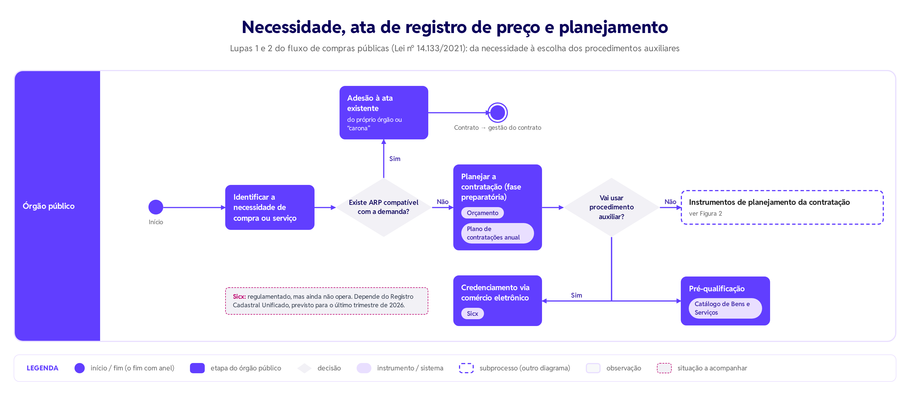
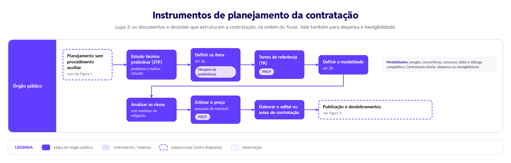
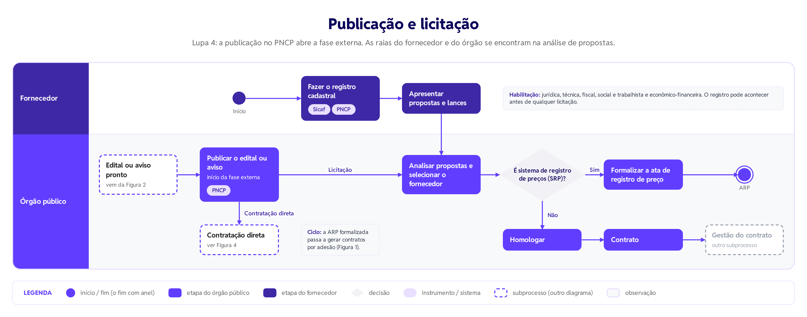
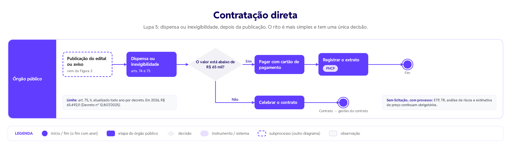

# Do pedido ao contrato: o fluxo das compras públicas

Como uma necessidade dentro de um órgão público vira compra. Este guia lê o fluxo operacional da Lei nº 14.133/2021, a Nova Lei de Licitações e Contratos Administrativos, bloco a bloco, com os conceitos que ajudam a enxergar a política por trás do procedimento.

<!-- more -->

## O desenho inteiro

O fluxo acompanha a primeira etapa da política de compras: da identificação da necessidade até a formalização da contratação. Tem dois atores, cada um com a sua raia: o **órgão público**, que compra, e o **fornecedor**, que vende. Ao longo do caminho há quatro pontos de decisão.

Para ler, siga primeiro a raia do órgão, da esquerda para a direita, e só depois volte à raia do fornecedor. As duas se encontram em um único ponto: a análise de propostas.

O fluxo completo foi dividido em quatro diagramas, que seguem os trechos do desenho original. Cada um termina num subprocesso que remete ao seguinte.

## 1. Necessidade e ata de registro de preço

Tudo começa quando o órgão identifica a necessidade de comprar um produto ou contratar um serviço. A primeira pergunta do fluxo não é como licitar, e sim **se já existe uma ata compatível com a demanda**.

- **Sim:** o órgão faz a adesão à ata existente e segue direto para o contrato, sem planejar uma licitação própria. A ata pode ser do próprio órgão ou de outro (a "carona"), sempre dentro das regras da lei. Dali o caminho continua no subprocesso de gestão do contrato.
- **Não:** o órgão inicia o planejamento de uma nova contratação.

*Figura 1. Necessidade, ata de registro de preço e planejamento: o órgão verifica se existe ARP compatível; se não, planeja a contratação e decide se vai usar um procedimento auxiliar.*

## 2. Planejamento e procedimentos auxiliares

Na fase preparatória, o órgão produz estudos e documentos e decide quais procedimentos e instrumentos vai usar. Duas entradas condicionam essa fase: o **orçamento** e o **plano de contratações anual**. A compra deve conversar com o planejamento estratégico e com os recursos disponíveis.

A pergunta seguinte é se o órgão vai usar um procedimento auxiliar.

- **Sim:** credenciamento via comércio eletrônico, contratação direta por inexigibilidade feita no Sistema de Compras Expressas (Sicx), ou pré-qualificação, em que itens e fornecedores aprovados passam a integrar o Catálogo de Bens e Serviços.
- **Não:** o órgão segue para os instrumentos de planejamento da contratação.

O Sicx foi regulamentado, mas ainda não está operando. A lei que incorporou o comércio eletrônico como forma de credenciamento foi sancionada em novembro de 2025, e o decreto que a regulamenta saiu em agosto de 2026. O sistema depende do Registro Cadastral Unificado, com lançamento previsto para o último trimestre de 2026.

## 3. Instrumentos de planejamento da contratação

O bloco central do fluxo reúne os documentos e decisões que estruturam a contratação, nesta ordem:

1. **Estudo técnico preliminar (ETP):** evidencia o problema e a melhor solução, para avaliar a viabilidade técnica e econômica.
2. **Definição dos itens:** decide se cabe a margem de preferência (art. 26 da Lei nº 14.133/2021).
3. **Termo de referência (TR)**, registrado no PNCP: objeto, fundamentação, solução, requisitos e critérios.
4. **Definição da modalidade:** a mais adequada ao valor, à natureza e à complexidade do objeto.
5. **Análise de riscos**, com medidas de mitigação.
6. **Estimativa de preço**, registrada no PNCP: pesquisa de mercado para o valor de referência.
7. **Edital ou aviso de contratação:** regras, objeto, condições de participação e critérios de julgamento.

*Figura 2. Instrumentos de planejamento da contratação: do estudo técnico preliminar ao edital ou aviso, na ordem do fluxo.*

| Modalidade ou hipótese | Quando se aplica |
|---|---|
| Pregão | Obrigatório para bens e serviços comuns, preferencialmente eletrônico, com disputa por lances. |
| Concorrência | Bens e serviços especiais e obras e serviços comuns e especiais de engenharia. |
| Concurso | Escolha de trabalho técnico, científico ou artístico, com prêmio ou remuneração. |
| Leilão | Venda de bens inservíveis ou apreendidos, ou alienação de imóveis, a quem der o maior lance. |
| Diálogo competitivo | A administração dialoga com licitantes selecionados para desenvolver alternativas quando o mercado não tem uma pronta. |
| Dispensa de licitação | A licitação é viável, mas a lei permite dispensá-la (valores baixos, emergências). |
| Inexigibilidade | A competição é inviável: fornecedor exclusivo ou objeto singular. |

## 4. Publicação e desdobramentos

Com o edital pronto, o órgão o publica no Portal Nacional de Contratações Públicas (PNCP). É a virada da fase interna para a fase externa: a intenção de contratar se torna pública. Daqui o fluxo se divide em licitação (concorrência ou pregão) e contratação direta.

Na via licitatória entra a raia do fornecedor: o registro cadastral no Sicaf, com as habilitações jurídica, técnica, fiscal, social e trabalhista e econômico-financeira; depois, a apresentação de propostas e lances. As raias se encontram na análise de propostas e seleção do fornecedor.

A pergunta seguinte é se a contratação usa o **sistema de registro de preços (SRP)**.

- **Sim:** formaliza-se a ata de registro de preço. A ata passa a gerar contratos por adesão.
- **Não:** homologação, depois contrato e gestão do contrato.

*Figura 3. Publicação e licitação: a publicação no PNCP abre a fase externa, e as raias do fornecedor e do órgão se encontram na análise de propostas.*

## 5. Contratação direta

Quando não há disputa entre fornecedores, depois da publicação percorrem-se as opções de contratação direta: dispensa ou inexigibilidade. O rito é mais simples e tem uma única decisão: **o valor está abaixo de R$ 65 mil?**

- **Sim:** a compra pode ser paga com cartão de pagamento, com posterior extrato registrado no PNCP.
- **Não:** celebra-se o contrato, que segue para a gestão do contrato, como na via licitatória.

O limite de R$ 65 mil arredonda o valor da dispensa para compras e serviços em geral (art. 75, II, da Lei nº 14.133/2021), atualizado todo ano por decreto. Em 2026, é de R$ 65.492,11 (Decreto nº 12.807/2025).

*Figura 4. Contratação direta: dispensa ou inexigibilidade, com uma única decisão sobre o valor da compra.*

## Como as coisas se conectam

Alguns padrões só aparecem quando se ligam pontos distantes do desenho.

**A ata de registro de preço fecha um ciclo.** Ela aparece três vezes: no começo ("existe ARP compatível?"), como resultado do SRP e como adesão. A licitação de um órgão pode abastecer as compras de muitos outros, e o fim de um processo vira o atalho de outro.

**Nem todo fim é um contrato.** Há fins com destinos diferentes: "ARP" e "Contrato". Uma licitação por SRP termina num compromisso para o futuro, não numa compra imediata.

**O fornecedor tem um caminho próprio.** O registro cadastral pode acontecer antes e independentemente de qualquer licitação. A raia do fornecedor só encosta na do órgão na análise de propostas.

**O PNCP é a espinha dorsal da transparência.** Ele aparece no termo de referência, na estimativa de preço, na publicação do edital, no cadastro do fornecedor e no extrato do cartão de pagamento, além da nota fiscal. Quase todo passo relevante deixa rastro público no mesmo portal.

**Contratar sem licitação não é contratar sem planejamento.** A bifurcação entre licitação e contratação direta só acontece depois da publicação. Até ali, dispensa e inexigibilidade passam pelos mesmos instrumentos: ETP, termo de referência, análise de riscos e estimativa de preço.

**A compra pública também é estratégica.** A margem de preferência, indicada na definição dos itens, usa o poder de compra do Estado para favorecer produtos nacionais e bens reciclados ou biodegradáveis. É o ponto em que o fluxo deixa de ser só administrativo.

## O fluxo como política pública

Os conceitos abaixo ajudam a ler o desenho como uma política pública, e não só como um procedimento administrativo.

**Ciclo de políticas públicas.** Modelo simples que organiza uma política em fases: agenda, formulação, tomada de decisão, implementação e avaliação. *No fluxo:* o fluxo inteiro é um retrato da implementação: mostra como uma decisão (comprar) se transforma em entrega concreta (o bem ou serviço).

**Atores.** Pessoas, organizações e grupos que participam de uma política. *No fluxo:* os dois atores principais têm raias próprias: o órgão público (quem compra) e o fornecedor (quem vende). Elas se tocam num único ponto, a análise de propostas.

**Fase interna e fase externa.** A fase interna (preparatória) acontece dentro do órgão: planejamento, estudos, documentos. A fase externa começa com a publicação do edital ou aviso, quando o mercado e a sociedade passam a participar e a acompanhar. *No fluxo:* a publicação no PNCP é a linha que divide o desenho em dois.

**Governança das contratações.** Conjunto de estruturas, processos e controles que garantem que as compras sigam a estratégia do órgão, gerem resultado e evitem riscos. *No fluxo:* o plano de contratações anual e a análise de riscos são peças dessa governança.

**Transparência ativa.** Divulgação de informações por iniciativa do próprio poder público, sem que alguém precise pedir. *No fluxo:* o registro sistemático no PNCP: termo de referência, estimativa de preço, publicação, cadastro do fornecedor e extrato do cartão.

**Accountability (prestação de contas).** Dever de quem gere recursos públicos de explicar e justificar suas decisões e se submeter ao controle social. *No fluxo:* os registros, atestes e extratos do fluxo produzem a memória que permite esse controle. O cartão dispensa contrato, mas exige prestação de contas.

**Poder de compra do Estado.** O volume de compras do setor público é grande o bastante para influenciar mercados. Por isso, a compra pública pode ser usada como recurso de inovação, fortalecimento da produção nacional ou práticas sustentáveis. *No fluxo:* a margem de preferência, decidida na definição dos itens.

**Desenvolvimento nacional sustentável.** Um dos objetivos das contratações na Lei nº 14.133/2021, ao lado da proposta mais vantajosa e da competição justa. *No fluxo:* aparece na margem de preferência.

**Economicidade e vantajosidade.** Economicidade é obter o melhor resultado com o menor custo possível; vantajosidade é o critério que justifica escolhas como a carona em uma ata ou a prorrogação de um contrato contínuo. *No fluxo:* a pergunta inicial sobre a ata e a adesão por carona.

**Isonomia e competitividade.** Princípios que garantem tratamento igual aos fornecedores e disputa real entre eles. São a razão de a licitação ser a regra e a contratação direta, a exceção. *No fluxo:* na via licitatória, fornecedores habilitados disputam propostas e lances em condições iguais.

## Glossário

**Ata de registro de preço (ARP).** Documento vinculativo, com caráter de compromisso para contratação futura, em que ficam registrados o objeto, os preços, os fornecedores, os órgãos participantes e as condições da contratação, conforme o edital.

**Carona (adesão à ata).** Uso, por um órgão que não participou da licitação, de uma ata gerenciada por outro órgão. Aproveita um processo já feito, desde que a demanda seja compatível e os limites legais sejam respeitados.

**Cartão de pagamento.** Meio de pagamento para despesas de pequeno valor, que dispensa a formalização de um contrato e exige prestação de contas.

**Dispensa e inexigibilidade.** Na dispensa, a competição seria possível, mas a lei autoriza não licitar. Na inexigibilidade, a competição é impossível. Nos dois casos há contratação sem licitação, mas não sem processo: o planejamento continua obrigatório.

**ETP e TR.** O ETP pergunta "qual é o problema e qual a melhor solução?"; o TR responde "como essa solução será contratada?".

**Habilitação.** Verificação de que o fornecedor tem condições jurídicas, técnicas, fiscais, trabalhistas e financeiras de cumprir o contrato. Fica registrada no Sicaf (Sistema de Cadastramento Unificado de Fornecedores).

**Homologação.** Ato em que a autoridade competente confirma a regularidade dos atos, ratifica o resultado e autoriza a assinatura do contrato.

**Margem de preferência.** Vantagem concedida, no julgamento das propostas, a bens manufaturados e serviços nacionais que atendam a normas técnicas brasileiras e a bens reciclados, recicláveis ou biodegradáveis. Instrumento de incentivo ao desenvolvimento nacional sustentável.

**Plano de contratações anual (PCA).** Documento em que o órgão consolida as compras e contratações que pretende fazer no ano seguinte. Liga cada compra ao planejamento e ao orçamento.

**PNCP.** Portal oficial criado pela Lei nº 14.133/2021 para divulgar os atos das contratações de todos os entes federativos: planos, editais, atas, contratos e notas fiscais.

**Procedimentos auxiliares.** Ferramentas da Lei nº 14.133/2021 para dar mais eficiência, agilidade e economia às contratações. Não são modalidades de licitação.

- *Credenciamento:* interessados que cumprem os requisitos se credenciam para executar o objeto quando convocados.
- *Pré-qualificação:* seleção prévia, por edital, das condições de habilitação dos interessados ou do objeto.
- *PMI:* a administração pede à iniciativa privada estudos e projetos de soluções inovadoras.
- *Sistema de registro de preços (SRP):* registra formalmente preços para contratações futuras.
- *Registro cadastral:* cadastro unificado de fornecedores.

## De onde vem este desenho

O fluxo da política de compras públicas e seu documento descritivo foram elaborados a partir de três bases: a Lei nº 14.133/2021, que estrutura etapas, instrumentos e atores; pesquisas em fontes oficiais do governo federal, que complementaram a lei com normas infralegais, sistemas e procedimentos adotados na prática; e cursos sobre procedimentos licitatórios da Escola Virtual da Enap, que apoiaram a interpretação das etapas.

Os diagramas desta publicação redesenham o fluxo a partir do guia de leitura, na identidade visual do Gov Hub. Conceitos e valores sujeitos a atualização periódica, como o limite da dispensa e a situação do Sistema de Compras Expressas, foram conferidos em fontes atualizadas até outubro de 2026.

Para saber mais: [Portal Nacional de Contratações Públicas (PNCP)](https://www.gov.br/pncp/pt-br) e [Catálogo de Bens e Serviços](https://catalogo.compras.gov.br/cnbs-web/busca).
