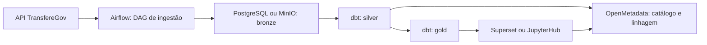

# OpenMetadata

O OpenMetadata é a referência de governança e catalogação de dados do GovHub BR. Ele ajuda a responder quais dados existem, de onde vieram, quem responde por eles, qual é a linhagem e quais cuidados de acesso ou sensibilidade se aplicam.

## Papel na governança

No GovHub, o OpenMetadata complementa o pipeline de dados. Airflow e dbt executam ingestão e transformação; PostgreSQL, MinIO e demais serviços armazenam ou expõem dados; o OpenMetadata organiza a visão de governança sobre esses ativos.

| Responsabilidade | Como aparece no GovHub |
| --- | --- |
| Catálogo | Registro de bases, tabelas, dashboards e produtos de dados. |
| Linhagem | Relação entre origem, ingestão, modelos dbt e consumo. |
| Ownership | Responsáveis técnicos e de domínio por datasets e produtos. |
| Classificação | Tags para sensibilidade, domínio, camada e regras de uso. |
| Rastreabilidade | Apoio à revisão de mudanças, auditoria e investigação de impacto. |

!!! info "Status a confirmar"
    O repositório de governança declarativa é a referência para catálogo, owners, domínios e classificações. Antes de depender de um recurso específico em produção, confirme com a equipe responsável se ele já está habilitado no ambiente alvo.

## Onde ficam as definições

| Item | Onde consultar ou alterar |
| --- | --- |
| Governança declarativa | [`openmetadata-declarative-governance`](https://github.com/GovHub-br/openmetadata-declarative-governance) |
| Modelos e metadados dbt | `airflow_lappis/dags/dbt/<projeto>/models/` no [`data-application-gov-hub`](https://github.com/GovHub-br/data-application-gov-hub) |
| DAGs relacionadas aos dados | `airflow_lappis/dags/` no `data-application-gov-hub` |
| Documentação técnica | Esta documentação, principalmente Arquitetura, Pipeline de Dados e Governança |
| Acessos e credenciais | [Controle de Acesso](acesso.md) e [Gerenciamento de Secrets](../infraestrutura/secrets.md) |

## Funcionalidades esperadas

| Feature | Descrição |
|---------|-----------|
| Catálogo | Descoberta de datasets por nome, domínio, camada ou responsável. |
| Linhagem | Rastreio entre fonte, ingestão, transformação e consumo. |
| Ownership | Indicação de responsáveis por dataset, domínio ou produto de dados. |
| Domínios | Organização por órgão, sistema estruturante ou área temática. |
| Qualidade | Associação com testes dbt e regras de qualidade quando disponíveis. |
| Tags | Classificação de sensibilidade, camada, origem e regra de acesso. |

## Domínios

| Domínio | Exemplos de datasets | Owner |
|---------|----------------------|-------|
| Transferências | `transferegov_*`, `fato_transferencias` | Equipe responsável pelo domínio |
| Pessoal | `siape_*`, `fato_servidores` | Equipe responsável pelo domínio |
| Financeiro | `siafi_*`, `execucao_financeira` | Equipe responsável pelo domínio |
| Compras | `comprasgov_*`, `fato_compras` | Equipe responsável pelo domínio |
| Organizacional | `siorg_*`, `dim_orgaos` | Equipe responsável pelo domínio |

Os owners devem refletir a responsabilidade real de manutenção e revisão. Evite usar um responsável genérico quando já existir um time de domínio definido.

## Linhagem



Quando a integração está habilitada, o OpenMetadata pode capturar linhagem a partir de metadados do dbt, conexões com bancos e integrações do Airflow. Caso a linhagem não apareça, confira primeiro se o ativo existe no catálogo e se o processo de ingestão de metadados foi executado no ambiente alvo.

## Configuração declarativa

O repositório [`openmetadata-declarative-governance`](https://github.com/GovHub-br/openmetadata-declarative-governance) permite manter governança como código. Use esse repositório para registrar ou revisar:

- domínios;
- times e usuários;
- produtos de dados;
- owners;
- tags e classificações;
- políticas ou metadados complementares, quando aplicável.

```yaml
# Exemplo ilustrativo, sem dados sensíveis
domains:
  - name: transferencias
    displayName: Transferências
    description: Dados de convênios, TEDs e transferências voluntárias
    owner: equipe-transferencias
    data_products:
      - gold.fato_transferencias
      - silver.transferencias
```

## Ao criar ou alterar um dataset

Antes de abrir PR com um novo dataset, confira se a documentação e a governança estão coerentes:

- o nome da tabela ou modelo segue o padrão do domínio;
- o `schema.yml` do dbt descreve o modelo e colunas principais;
- o owner técnico ou time responsável está claro;
- a camada do dado está identificada (`bronze`, `silver` ou `gold`);
- a sensibilidade do dado foi avaliada;
- dashboards ou notebooks consumidores foram identificados, se existirem;
- variáveis, connections e secrets necessárias foram documentadas sem expor valores reais.

## Como completar a configuração

| Item | Status | Como completar |
|------|--------|----------------|
| Catálogo de tabelas | Funcional quando o conector está habilitado | Conferir ingestão de metadados do banco no ambiente alvo. |
| Linhagem dbt | Funcional quando artefatos dbt são publicados | Conferir `manifest.json`, `catalog.json` e configuração do conector. |
| Owners por dataset | Parcial | Declarar no repositório de governança e revisar com o time responsável. |
| Domínios por fork ou órgão | Parcial | Criar domínios para cada iniciativa quando houver dados publicados. |
| Tags de sensibilidade | Pendente ou parcial | Classificar bases com dados pessoais, sensíveis ou restritos. |
| Testes de qualidade | Parcial | Relacionar testes dbt relevantes aos ativos catalogados. |

## Referências

- [OpenMetadata Docs](https://docs.open-metadata.org/)
- [`openmetadata-declarative-governance`](https://github.com/GovHub-br/openmetadata-declarative-governance)
- [Padrões de Engenharia](../pipeline/padroes-engenharia.md)
- [Gerenciamento de Secrets](../infraestrutura/secrets.md)
